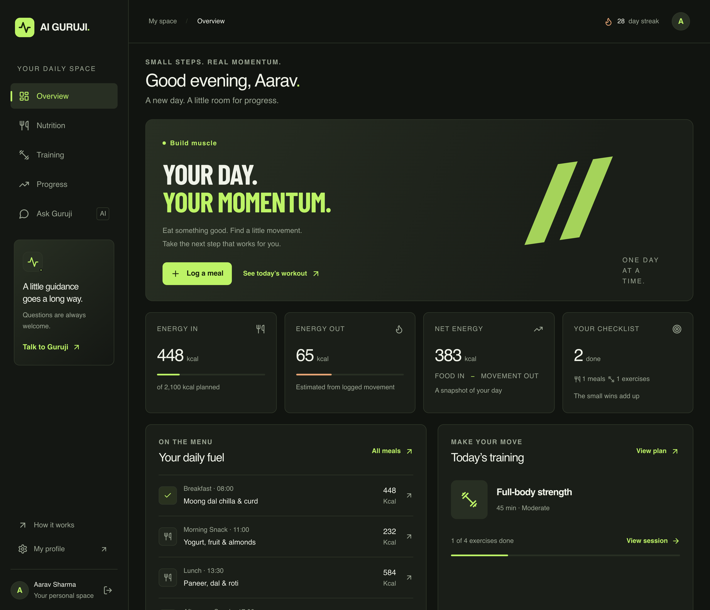
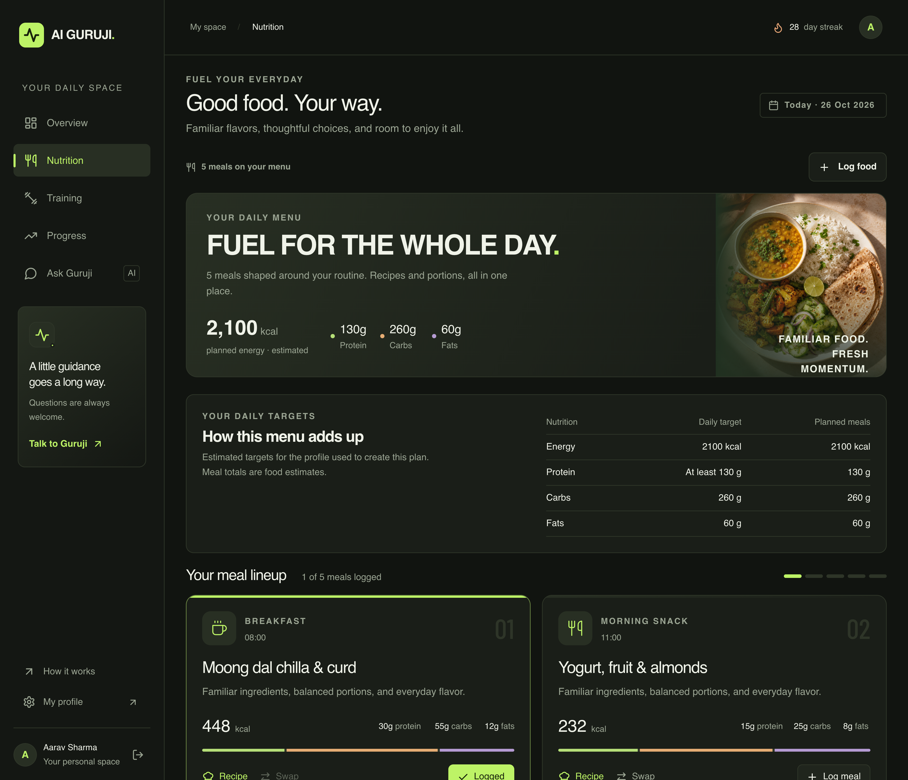
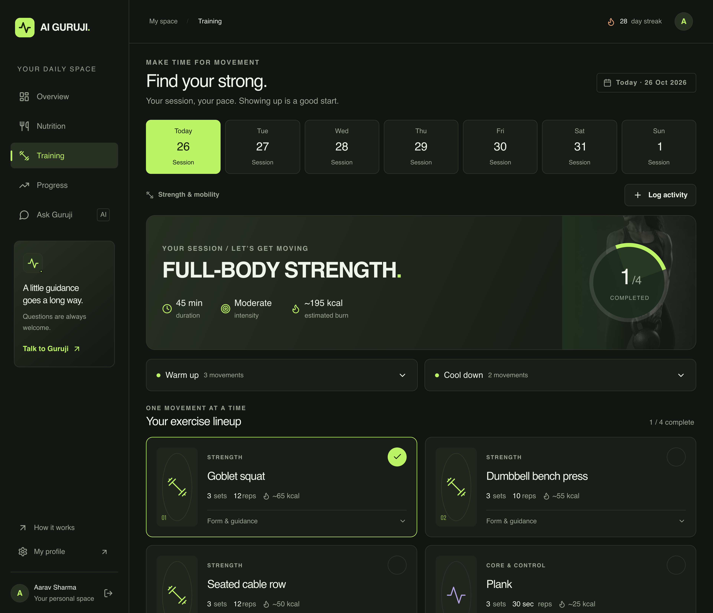
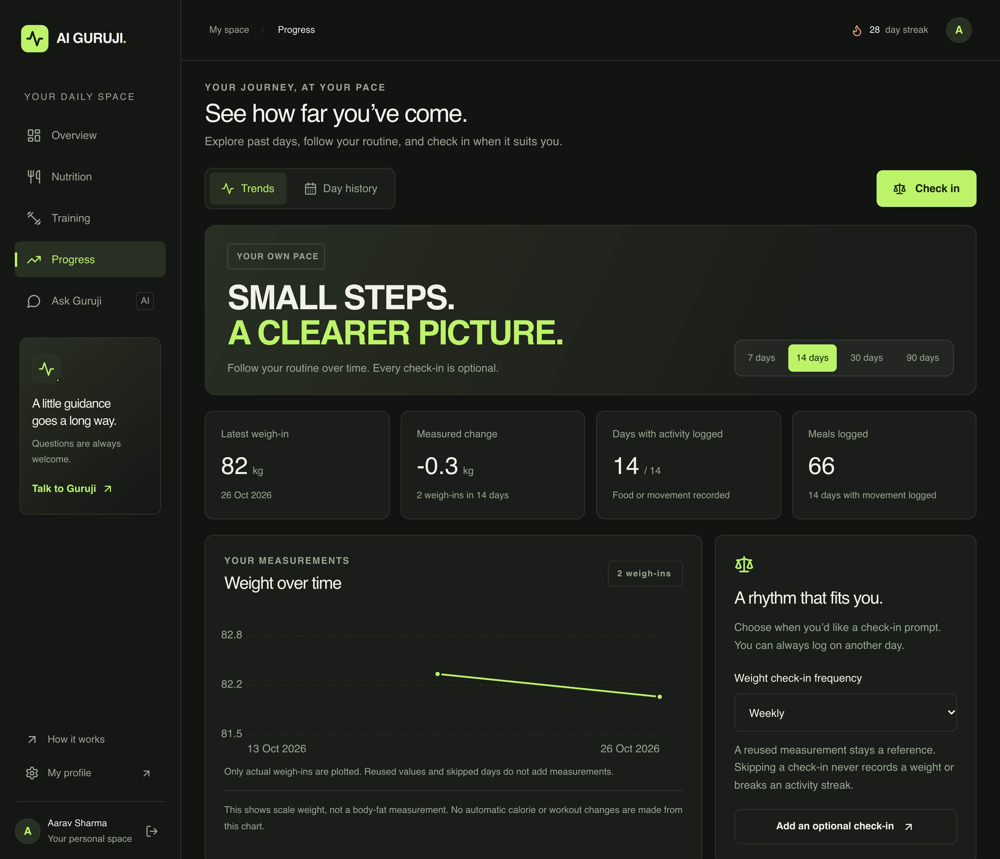
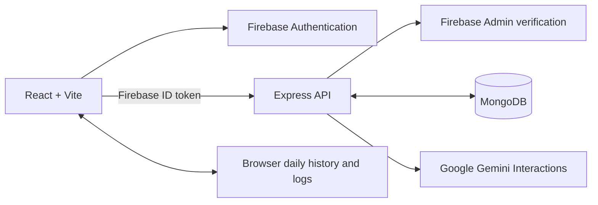

# AI Guruji

**Created by [Dravin Gupta](https://dravingupta.vercel.app/)** · Full-stack fitness & nutrition project

[Portfolio](https://dravingupta.vercel.app/) · [Architecture](docs/ARCHITECTURE.md) · [Design notes](docs/DESIGN.md)

AI Guruji brings personalized Indian meal plans, weekly workouts, daily logging, weight trends, and focused AI follow-ups into one responsive web app. It is built around a practical question: how can a fitness tool help with the everyday decisions that come *after* receiving a plan?

The public **`/how-it-works`** page is a guided product walkthrough with screenshots and engineering decisions. It can be explored without signing in.



*Screenshots use a fictional profile and illustrative plans. All four images are lossless 3840 × 3300 PNG exports; open an image to inspect it at full resolution.*

## The product

| Area | What it does |
| --- | --- |
| Personalized nutrition | Indian meal suggestions informed by food preferences, region, budget, and allergy instructions; recipes with quantities and estimated macros. |
| Reusable daily targets | Saves AI-estimated calorie and macro targets on the profile, or uses the user's custom macros. Relevant profile changes and significant weight changes trigger a review. |
| Flexible meal schedules | Supports 2–6 meals with personal labels, optional times, and separate snack slots. Meals and swaps are checked against the saved daily targets. |
| Training | Generates a seven-day plan for home or gym, with exercise instructions, sets, reps, warm-ups and cooldowns. |
| Daily tracking & progress | Logs meals and activity, shows saved-day history, and charts actual weight measurements. Weigh-ins can be measured, reused, or skipped. |
| Ask Guruji | Answers short questions about portions, substitutions, exercise technique, recovery and app use. Full-plan requests go to the dedicated planning screens. |
| Account & interface | Google/email sign-in, profile onboarding and editing, a responsive dark interface, and clear startup/retry states. |

### A closer look

| Nutrition | Training |
| --- | --- |
|  |  |



## Engineering decisions

This project covers the product flow, React interface, authenticated API, persistence, and model integration. A few decisions are central to how it works:

- **Resolve targets once, then reuse them.** Daily menu generation uses saved profile targets. Automatic targets are reassessed when relevant inputs change, including a configurable weight change from the previous target basis (5% by default). Custom macros remain authoritative.
- **Check AI output before saving it.** Structured JSON is followed by application validation: every scheduled meal must exist, protein must meet the target, and daily totals and meal energy must stay within defined tolerances. Invalid completed output gets at most one correction per stage.
- **Preserve the user's record.** Changing preferences flags cached menus for explicit rebuilding. Rebuilding retains logged food; historical snapshots keep their original targets and schedule.
- **Enforce identity on the server.** Firebase ID tokens are verified by the API. The verified UID owns profiles and weight records; request-supplied account IDs do not determine ownership.
- **Handle slow startup deliberately.** Safe profile reads have bounded retries and cancellation. A backend failure cannot be mistaken for a new user who needs onboarding.
- **Bound AI requests.** Gemini calls have a timeout and no automatic transport retries. Concurrent target/menu requests share work within one API process. Chat uses a scope decision before generating a contextual answer.

These rules have regression coverage, including the case where a menu contains **87 g of protein against a 130 g target** and must be rejected or corrected.

## Architecture



| Layer | Technology |
| --- | --- |
| Frontend | React 18, Vite 7, React Router 7, Tailwind CSS 3, custom CSS, Lucide icons |
| Backend | Node.js 24, Express 4, JavaScript ES modules |
| Identity | Firebase Authentication and modular Firebase Admin SDK |
| Database | MongoDB with Mongoose |
| AI | Official `@google/genai` SDK; Gemini Interactions API; configurable model |
| Verification | Node test runner, production Vite build, browser review |
| Hosting configuration | Vercel frontend and Render backend; lockfile-based `npm ci` installs |

### Data boundaries

| Data | Current storage |
| --- | --- |
| Profile, reusable targets, meal schedule, weight journal | Account-owned MongoDB records |
| Generated diet and workout records | MongoDB, plus browser working copies |
| Meal/exercise completion, manual logs, swapped working menus, chat | Browser-local, scoped to the user |

Daily history does not currently hydrate from the server across devices. Clearing browser storage can remove local tracking and chat. Day keys currently use UTC.

Nutrition values are model estimates. Validation checks structure and arithmetic; it is not an ingredient-composition database or a deterministic allergen checker. Workout and chat failures still have fallback responses. These and other implementation limits are documented in the [architecture reference](docs/ARCHITECTURE.md#9-known-gaps-and-behavior-traps).

## Run locally

You need **Node.js 24**, MongoDB, a Firebase project with Google/email sign-in enabled, and a Google Gemini API key. The client and backend are independent npm packages.

From the project directory:

```bash
nvm use
npm ci --prefix backend
npm ci --prefix client
```

If Node 24 is not installed, run `nvm install` before `nvm use`, or install Node 24 through your preferred runtime manager.

### Configure the environment

For a fresh checkout, copy [backend/.env.example](backend/.env.example) to `backend/.env` and [client/.env.example](client/.env.example) to `client/.env`. Edit existing environment files in place.

| Backend setting | Purpose |
| --- | --- |
| `MONGODB_URI` | Local MongoDB or Atlas connection string |
| `FRONTEND_URL` | Frontend origin; locally `http://localhost:5173` |
| `GEMINI_API_KEY` | Google API key, kept on the server |
| `GEMINI_MODEL` | Defaults to `gemini-3.6-flash` |
| `FIREBASE_PROJECT_ID`, `FIREBASE_CLIENT_EMAIL`, `FIREBASE_PRIVATE_KEY` | Firebase Admin service-account credentials; `FIREBASE_SERVICE_ACCOUNT` JSON is an alternative |
| `PORT` | Defaults to `5000` |

The client needs the Firebase web app values listed in its template and `VITE_API_URL=http://localhost:5000/api`. Use the same Firebase project on both sides. The `/api` suffix is required. Browser `VITE_*` settings are public build values; Gemini keys, MongoDB credentials, and Firebase Admin private keys belong only in the backend environment.

Run each package in its own terminal:

```bash
# Terminal 1
cd backend
npm run dev
```

```bash
# Terminal 2, starting at the repository root
cd client
npm run dev
```

Open `http://localhost:5173`. The public walkthrough is at `/how-it-works`; backend readiness is at `http://localhost:5000/api/health`.

If port 5000 is occupied, change backend `PORT` and client `VITE_API_URL` together, then restart both servers. Also update the Vite proxy target if you use a relative `/api` URL.

## Verify changes

Run from the repository root:

```bash
npm test --prefix backend
npm test --prefix client
npm run build --prefix client
```

The suites cover authentication ownership, startup retries, nutrition targets and validation, personalized meal slots, logged-food preservation, chat scope, and weight tracking. Automated tests use synthetic data and mocks; they do not require paid Gemini requests or production database writes.

For a current dependency report, run `npm audit` inside each package. Keep both lockfiles with changes and review dependency overrides when upgrading their parent packages.

## Deploy

| Setting | Frontend: Vercel | Backend: Render |
| --- | --- | --- |
| Root directory | `client` | `backend` |
| Node version | `24.x` | `24.x` |
| Install/build | `npm ci`, then `npm run build` | `npm ci` |
| Output/start | `dist` | `npm start` |
| Health check | — | `/api/health` |
| Configuration | [client/vercel.json](client/vercel.json) | [backend/render.yaml](backend/render.yaml) |

Set deployment environment variables separately; local `.env` files are not uploaded by Git. The frontend's `VITE_API_URL` must point to the backend HTTPS URL including `/api`, and backend `FRONTEND_URL` must match the frontend origin. Add the deployed frontend hostname to Firebase Authentication's authorized domains. Rebuild the client after changing its Vite environment values.

Before sharing the deployed app, confirm readiness returns 200 and test sign-in, profile loading, and meal generation in that environment.

## Explore the code

```text
backend/
  src/config/          Database and Firebase initialization
  src/controllers/     Profile, plans, chat, progress and readiness
  src/middlewares/     Firebase ID-token verification
  src/models/          MongoDB schemas
  src/services/        Gemini integration, target resolution and validation
  src/contracts/       Pure nutrition schedule and profile contracts
  test/                Backend regression tests
client/
  src/components/      Product screens and shared interface controls
  src/contexts/        Authentication and session state
  src/hooks/           Progress and nutrition-profile state
  src/services/        Authenticated API client
  src/contracts/       Browser mirror of pure nutrition contracts
  src/utils/           Tracking, history and startup helpers
  test/                Client regression tests
  public/images/       Product screenshots and visual assets
docs/                  Architecture, product decisions and design notes
```

Start with [AGENTS.md](AGENTS.md) for repository conventions, [ARCHITECTURE.md](docs/ARCHITECTURE.md) for flows and API contracts, or [DESIGN.md](docs/DESIGN.md) for visual decisions. The historical `deepseekService.js` filename now contains Gemini-backed prompts and response handling.

## Author & attribution

**AI Guruji is a project by Dravin Gupta.**

[Explore Dravin's portfolio](https://dravingupta.vercel.app/)

If you reference, demonstrate, or adapt this project, clearly credit Dravin Gupta and link to his portfolio. Please do not present a copied version as your own original work.

Built with React, Vite, Express, MongoDB, Firebase, Google Gemini, Tailwind CSS and Lucide. Credit for those libraries and services belongs to their respective authors.
