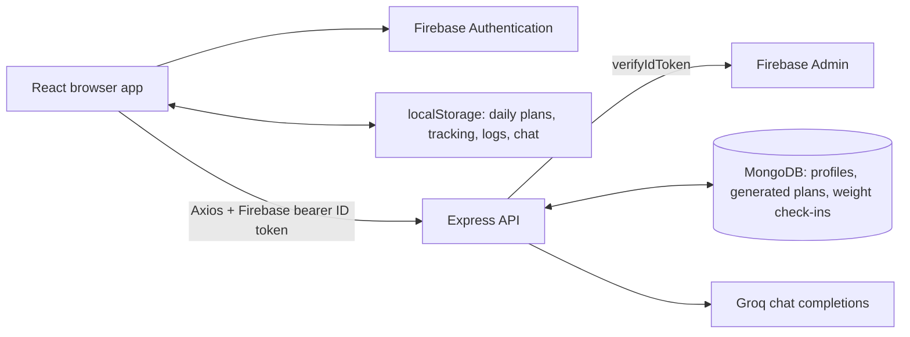

# AI Guruji architecture and change reference

Source audit: **25 October 2026**, baseline commit `099a758` (`Revise README to reflect project updates and features`). This documents the checked-in implementation, including incomplete behavior. It is not a claim that deployed services were tested. Paths are relative to the Git root containing `backend/` and `client/`.

Scoped AI update, 25 October 2026: the existing key returned `404 model_not_found` for the old Llama model and successfully completed chat, diet, seven-day workout, and meal-swap requests with `openai/gpt-oss-120b`. Model configuration, JSON mode, timeout, credential logging, and chat-history transport were updated and checked. These live service-level checks used synthetic profiles and did not test authenticated browser/API flows or write database records.

Scoped conversation update, 25 October 2026: chat behavior now uses a dedicated query-first assistant policy and relevant saved profile context instead of the former "encouraging but strict" instruction. New greetings and connection-failure messages are neutral, and chat bubbles preserve line breaks. Existing saved messages are retained.

Scoped UI update, 25 October 2026: complete athletic dark redesign across landing, authentication, onboarding, dashboard, nutrition, training, coach, and dialogs. Routes, Firebase authentication, API contracts, and localStorage key shapes are preserved. UI behavior was checked with isolated synthetic data; no new authenticated backend or live AI verification was performed for the redesign. See [design notes](DESIGN.md).

Scoped refinement update, 25 October 2026: existing profiles now open in view mode at `/profile`, with editing at `/profile/edit`. Nutrition displays four ordered meal slots, preserves extra legacy meals, and identifies missing slots. New daily plans require four distinct validated meals; no static diet/swap fallback is saved on generation failure. Overview includes dinner, swapped calories update targets, and replacing an incomplete plan retains eaten meals in the local journal. Training has a saved-data week strip, session progress ring, and movement cards. Pure greetings bypass the LLM; assistant replies render safe basic Markdown. Both packages have `npm test` regression suites. Browser review used synthetic desktop/mobile data; no live authenticated provider/database flow was exercised for this refinement.

Scoped chat-scope update, 25 October 2026: Guruji now stays within fitness, nutrition, recovery, everyday wellbeing, and app help. Non-greeting messages first receive a separate JSON scope decision without saved profile or assistant messages. Off-topic requests, including programming even when fitness-related, return a fixed short redirect without an answer-generation call. In-scope messages retain profile-aware conversation. Invalid/failed decisions return the existing connection-trouble message. Old local chat history remains saved. Live service checks with a synthetic profile passed six cases: generic Python, fitness-related Python, scope-override coding, unrelated trivia, vegetarian protein sources, and a contextual breakfast follow-up. The four unrelated cases returned the fixed redirect; the two relevant cases answered normally despite a strict legacy assistant reply. No authentication flow or database writes were exercised.

Scoped trainer-follow-up update, 25 October 2026 (supersedes the broader chat role above): Guruji answers small practical questions users would message their trainer after receiving a diet/workout plan. One-meal suggestions/substitutions, portions, technique, missed sessions, recovery, and routine/app questions remain welcome; complete programmes, multi-day schedules, essays, and unrelated tasks are redirected. Answers target 1–3 sentences, usually under 80 words; technique explanations may use up to five brief bullets / 120 words. This length is prompt guidance, not a hard word-count validator. The chat request now optionally includes the selected day's browser working plans; `coachContext.js` projects useful data fields and excludes arbitrary metadata. No rate limits or local keyword blocking were added. Verification: 12 backend tests, 3 client tests, production client build, and 7 live service scenarios using a synthetic profile/plan. Live replies used the supplied lunch portion and squat prescription, clarified missing dinner details, and redirected complete programmes/coding/long essays; greeting stayed brief. No real account changes or database writes were made.

Scoped progress update, 25 October 2026: Overview/Nutrition/Coach use today; Training previews today plus six upcoming days. `/progress` has Trends and Day history, with historical plans shown read-only and no historical generation. Weight check-ins (measured/reused/skipped) and cadence are account-owned MongoDB records. Charts use actual measurements only; latest measured weight is used for future AI requests without overwriting the profile baseline or regenerating current plans. Activity history remains device-local. An empty today no longer erases yesterday's activity streak. See [product vision](PRODUCT_VISION.md) for delivered behavior and recommended finish order.

Scoped public-tour/light-theme update, 25 October 2026: `/how-it-works` is a lazy-loaded public product walkthrough accessible without signing in and also from the dashboard. It presents the problem, user journey, four real app screenshots with synthetic data, trainer-follow-up scope, stack/engineering decisions, and honest storage boundaries. Landing and walkthrough both offer theme toggles. Light appearance now uses a consistent sand/linen canvas, terracotta actions, and olive completion/session panels; dark tokens are preserved. Overview has an arched athlete image on desktop and a compact movement graphic on phones. The former alternating pastel fills were removed, and the light product screenshots were refreshed. Overview has no date badge; Nutrition and Training keep their date context. No API, authentication, or storage contracts changed.

## Navigation

- [1. Project at a glance](#1-project-at-a-glance)
- [2. Source file map](#2-source-file-map)
- [3. Frontend runtime and user flows](#3-frontend-runtime-and-user-flows)
- [4. Backend lifecycle and API contract](#4-backend-lifecycle-and-api-contract)
- [5. MongoDB data contracts](#5-mongodb-data-contracts)
- [6. Browser persistence and calculations](#6-browser-persistence-and-calculations)
- [7. AI integration](#7-ai-integration)
- [8. Configuration, local setup, and deployment](#8-configuration-local-setup-and-deployment)
- [9. Known gaps and behavior traps](#9-known-gaps-and-behavior-traps)
- [10. Change map](#10-change-map)
- [11. Verification and troubleshooting](#11-verification-and-troubleshooting)
- [12. Maintaining this reference](#12-maintaining-this-reference)

## 1. Project at a glance

AI Guruji is an Indian fitness-coach web app. Users authenticate, create a fitness profile, receive daily diet and seven-day workout plans, log meals/exercise, and chat with an AI coach.

There are two independent npm packages, both JavaScript ES modules. There is no monorepo manager, root package, TypeScript, global state library, background worker, or separate AI microservice.

| Layer | Implementation and responsibility |
| --- | --- |
| Browser UI | React `^18.2.0`, React Router DOM `^6.30.2`, Vite `^5.0.0` |
| UI styling | Tailwind `^3.3.5`, PostCSS/Autoprefixer, Lucide React icons, DM Sans body and Barlow Condensed display fonts |
| Client identity | Firebase JS SDK `^10.0.0`: Google popup and email/password |
| Client HTTP | Axios `^1.6.0`; bearer token added per request |
| API | Express `^4.18.2`, cors, dotenv; Node ES modules |
| Server identity | Firebase Admin `^12.0.0`: verifies Firebase ID tokens |
| Persistent server data | MongoDB via Mongoose `^8.0.0` |
| Generation | Groq chat-completions HTTP API; `GROQ_MODEL`, default `openai/gpt-oss-120b` |
| Daily working data | React state + UID/date-scoped localStorage |
| Deployment configuration | Vercel SPA rewrite for client; Render service YAML for API |

Versions above are manifest ranges, not a verified installed or latest dependency set.



**The central persistence rule:** MongoDB is the backend source for the profile, optional weight journal/cadence, and generated-plan records. The dashboard's working history comes from localStorage; it never hydrates from the server history APIs. Clearing browser storage or using another browser can trigger new generation despite existing MongoDB records. Firebase stores identity, not the app's fitness profile.

## 2. Source file map

This map covers all application source and tracked configuration files in the audited baseline. Read only the relevant entries for a change.

### Client bootstrap, state, and configuration

| File | Responsibility / important symbols |
| --- | --- |
| `client/package.json` | Dependencies and `dev`, `build`, `preview`, `test` scripts |
| `client/.env.example` | Copyable browser configuration template; VITE_API_URL and Firebase web app fields |
| `client/index.html` | `#root` with a static branded loading fallback before React; dark initial class, page metadata, favicon link, Google Fonts URLs, module entry |
| `client/public/favicon.svg` | Scalable lime activity-mark favicon matching the shared Brand logo |
| `client/src/main.jsx` | React root; wraps `App` in `React.StrictMode` |
| `client/src/App.jsx` | `ThemeProvider` → `AuthProvider` → `AppRouter` |
| `client/src/AppRouter.jsx` | Route guards; loading screen; dashboard/profile prop adapters; `handleSave` |
| `client/src/contexts/AuthContext.jsx` | Firebase listener; `user`, `userProfile`, `loading`, `error`; `logout`, `refreshProfile`, `retrySession`, named `useAuth`; always renders children and owns cancellable session/profile startup |
| `client/src/contexts/ThemeContext.jsx` | `theme`, `toggleTheme`, named `useTheme`; localStorage and document `.dark` class |
| `client/src/hooks/useAuth.js` | Default re-export of context hook; no separate state |
| `client/src/hooks/useTheme.js` | Default re-export of context hook; no separate state |
| `client/src/config/firebase.js` | Browser Firebase app and exported `auth`; reads Vite env |
| `client/src/services/api.js` | Shared Axios instance and async ID-token request interceptor |
| `client/src/services/backendService.js` | API helpers returning `response.data`; `chatWithCoach` returns `.text`; body-image stub |
| `client/src/constants.js` | Exact user-facing strings for dietary preference, goal, activity, body type |
| `client/src/index.css` | Shared CSS variables, complete athletic dark/light design system, screen layouts, responsive breakpoints, reduced-motion styles |
| `client/tailwind.config.js` | Source scanning, class-based dark mode, DM Sans as `font-sans` and Barlow Condensed as `font-display` |
| `client/postcss.config.js` | Tailwind and Autoprefixer plugins |
| `client/vite.config.js` | React plugin and development `/api` proxy to port 5000 |
| `client/vercel.json` | Rewrite all routes to `/index.html` for browser routing |
| `client/metadata.json` | AI Studio metadata; Gemini description is historical, not active integration |
| `client/README.md` | Historical AI Studio/Gemini setup; use section 8 here for actual runtime configuration |
| `client/.gitignore` | Client dependency/build/editor ignores |

### Client screens and components

| File | Responsibility / principal edit locations |
| --- | --- |
| `client/src/components/StartupScreen.jsx` | Branded session/backend/page loading and retry/sign-out error states; honest elapsed time, indeterminate animation, public tour escape link |
| `client/src/utils/backendStartup.js` | Bounded safe-read retries, cancellation/deadlines, owned profile validation, strict missing-profile recognition |
| `client/test/backend-startup.test.js` | Cold-start failures, HTML responses, exact 404 vs infrastructure errors, UID ownership, hung requests and cancellation |
| `client/src/components/LandingPage.jsx` | Marketing page; auth callbacks, theme toggle, links to the public walkthrough |
| `client/src/components/HowItWorks.jsx` | Public product story, user journey, screenshot gallery/native enlargement dialog, stack and storage disclosure; reads auth only to select its CTA destination |
| `client/public/images/product/*.webp` | Four optimized real UI screenshots (Overview, Nutrition, Training, Progress), using isolated synthetic data; refresh when the UI changes |
| `client/src/components/Auth.jsx` | Firebase Google login, email sign-in/sign-up, error display; route change is driven by auth state |
| `client/src/components/ProfileOverview.jsx` | Read-only identity, body measurements, goals, preferences, notes, device-local activity snapshot, explicit Edit callback |
| `client/src/components/ProfileForm.jsx` | Three-step create/edit form; inline validation; allergy/macro state; Firebase identity defaults; saving/cancel/error props |
| `client/src/components/Dashboard.jsx` | Feature coordinator: sidebar/mobile navigation, overview metrics and real weekly bars, date navigation, generation, local caches, tracking, swaps, log dialogs |
| `client/src/components/Progress.jsx` | Trends/ranges/weight chart, actual activity summaries, preferences/journal, and read-only Day history |
| `client/src/components/WeightCheckIn.jsx` | Optional dated measured/reused/skipped entry dialog; notes, validation, save errors |
| `client/src/hooks/useProgress.js` | Authenticated progress API state, retry/save/preferences; no browser weight cache or silent offline success |
| `client/src/utils/progressData.js` | UTC date helpers, safe browser-day reads, measured-only weight summaries, activity summaries/streak, check-in due logic, today/preview date separation |
| `client/src/components/DietCard.jsx` | Meal list and completion callbacks; internal `RecipeModal`; exported `AddMealModal` |
| `client/src/components/WorkoutCard.jsx` | Warmup/exercises/cooldown and completion progress; exported `AddWorkoutModal` and manual calorie estimate |
| `client/src/components/ui.jsx` | Shared Brand, Button, IconButton, Field, Choice, Tag, SectionHeading, CoachMark, TextLink, and accessible native Modal |
| `client/public/images/athlete.png` | Generated monochrome athletic hero image used on landing/login |
| `client/public/images/food.png` | Generated Indian food editorial image used on landing |
| `client/test/*.test.js` | Node regression checks for safe chat rendering and preserving logged meals |
| `docs/DESIGN.md` | Redesign direction, screen ownership, exact asset prompts, and verification |
| `client/src/components/ChatMessage.jsx` | Safe React renderer for basic emphasis, code, paragraphs, headings, and lists; never evaluates raw HTML |
| `client/src/utils/mealPlanReplacement.js` | Pure `retainLoggedMeals` helper used when replacing incomplete plans; keeps consumed meal IDs/calories valid |
| `client/src/components/ChatCoach.jsx` | Controlled message history; textarea with Enter/Shift+Enter; suggestions; input/loading/scroll state; `handleSend` |

Dashboard logic is organized by symbols: `get*Key`, `initTrackingIfMissing`, `handleGenerateDiet`, `handleGenerateWorkout`, loading effect, `saveTracking`, `handleDateChange`, `handleSwapMeal`, `toggleMeal`, `addManualMeal`, `toggleExercise`, `addManualWorkout`, `getBadgeStats`, `getWeeklyData`, then render helpers and JSX. Burn calculation lives in top-level `getEstimatedBurn` / `computeBurnedToday`. There is no separate tracking service.

### Backend and repository files

| File | Responsibility |
| --- | --- |
| `backend/package.json` | Dependencies, `start` / `dev` / `test`, ESM mode |
| `backend/test/chat-scope.test.js` | Scope/whole-plan redirects, profile exclusion, relevant/legacy follow-ups, optional plan context transport, invalid decisions |
| `backend/test/coach-context.test.js` | Plan field projection/bounds and distinction between missing plans and actual recovery sessions |
| `backend/test/coach-and-plans.test.js` | Node regressions for greetings, complete meal validation, and mocked provider integration |
| `backend/.env.example` | Copyable server configuration template; MongoDB, Groq, Firebase Admin, server/origin settings |
| `backend/src/server.js` | dotenv loading, DB/Firebase initialization, HTTP listener |
| `backend/src/app.js` | Express instance, CORS, JSON limit, six route mounts, health response, final error handler |
| `backend/src/config/database.js` | `connectDB`; Mongoose connection; exits process on connection failure |
| `backend/src/config/firebase.js` | `initializeFirebase`; service-account JSON or separate environment fields |
| `backend/src/middlewares/authMiddleware.js` | `verifyToken`; assigns verified `{ uid, email }` to `req.user` |
| `backend/src/routes/authRoutes.js` | Auth verification route |
| `backend/src/routes/userRoutes.js` | Profile read/upsert/delete routes |
| `backend/src/routes/dietRoutes.js` | Diet generate/history/swap routes |
| `backend/src/routes/workoutRoutes.js` | Workout generate/history routes |
| `backend/src/routes/chatRoutes.js` | Chat message/history routes |
| `backend/src/controllers/healthController.js` | Public `/api/health` readiness: MongoDB connected and Firebase Admin initialized; no-store JSON; no model call |
| `backend/test/health.test.js` | Readiness/startup status, public payload and cache policy |
| `backend/src/controllers/authController.js` | `verifyUser`: profile existence lookup only |
| `backend/src/controllers/userController.js` | `getProfile`, `createOrUpdateProfile`, `deleteProfile` |
| `backend/src/controllers/dietController.js` | `createDietPlan`, `getDietHistory`, `swapDietMeal`; also has unused import of `app.js` |
| `backend/src/controllers/workoutController.js` | `createWorkoutPlan`, `getWorkoutHistory`; saves one document per returned day |
| `backend/src/controllers/chatController.js` | `sendMessage`, `getChatHistory`; no history writes |
| `backend/src/models/WeightCheckIn.js` | Unique account/date weight entry; measured/reused/skipped and optional note/source date |
| `backend/src/controllers/progressController.js` | Get owned journal, upsert a validated check-in, save cadence; UID always comes from token |
| `backend/src/routes/progressRoutes.js` | Protected progress endpoints with shared verifyToken |
| `backend/src/services/progressValidation.js` | Valid calendar dates, no future entries, measured weight bounds/precision, status/note/cadence validation |
| `backend/src/services/profileContextService.js` | `withLatestWeight` uses latest actual check-in in transient AI profile context; preserves original User.weight |
| `backend/test/progress.test.js` | Validation, UID ownership, explicit reuse, no-weight overwrite, preference ownership, latest-weight context |
| `backend/src/models/User.js` | Profile schema |
| `backend/src/models/DietPlan.js` | Diet and nested meal/recipe schema |
| `backend/src/models/WorkoutPlan.js` | Daily workout and nested exercise schema |
| `backend/src/models/ChatHistory.js` | History schema; read path exists but send does not write it |
| `backend/src/services/deepseekService.js` | Groq HTTP, plan prompts, parsing, fallback data, generated IDs; uses the chat policy builder |
| `backend/src/services/dietPlanValidation.js` | `normalizeMeal`, `normalizeDietPlan`, four-slot order, numeric nutrition and recipe validation, derived total calories |
| `backend/src/services/chatScope.js` | Trainer-follow-up scope classifier; in_scope / plan_request / off_topic; bounded user-only context, strict parsing, fixed redirects |
| `backend/src/services/coachContext.js` | `summarizePlanContext`: projects selected-day browser meal ingredients/portions, macros, exercise prescriptions/form, warmup/cooldown; excludes arbitrary metadata |
| `backend/src/services/coachPrompt.js` | `getGreetingResponse` (deterministic brief greeting); `buildCoachPrompt`: conversational behavior, relevant saved profile context, formatting and app-action boundaries |
| `backend/render.yaml` | Render web service configuration |
| `.gitignore` | Ignores env files, node_modules, output, and package-lock.json |
| `README.md` | Product overview; links to this reference; older sections have discrepancies listed below |
| `AGENTS.md` | Short automatic entry point for future agents |
| `docs/ARCHITECTURE.md` | This implementation reference |

No tracked test files, CI workflows, migration files, Docker files, or LICENSE file exist in the audited baseline. Configuration templates `client/.env.example` and `backend/.env.example` were added on 25 October 2026 after the initial source audit. A local backend lockfile may exist, but lockfiles are ignored and untracked.

## 3. Frontend runtime and user flows

### Authentication and routing

`main.jsx` mounts `App` with `ThemeProvider` outside `AuthProvider`, so startup respects the saved appearance. The HTML root includes a small branded fallback until React mounts. `AuthProvider` always renders its children: router guards show `StartupScreen` during session restoration/profile loading or a retryable connection error, rather than hiding the entire UI. `/how-it-works` is public even during loading/errors.

`onAuthStateChanged` publishes the Firebase user immediately, clears stale profile/error state, and loads `/users/profile`. Only a 404 JSON response with `{ error: 'Profile not found' }` permits onboarding. Network/5xx failures and invalid/HTML/wrong-UID responses retry within **120 seconds**, with **15-second per-attempt limits** and **2.5-second gaps**. Other HTTP errors do not auto-retry. Pending reads are aborted on auth changes, retries, and unmount; revision checks prevent stale account responses from updating state. Initial Firebase restoration has a separate 20-second error timeout. Retry restarts the profile load (or reloads the page if no Firebase identity exists); sign-out clears the state through the auth listener without deleting localStorage.

Signed-out visitors can use the landing/auth/tour while one anonymous bounded `GET /api/health` warm-up runs. It stops when ready, on auth change/unmount, or after the retry window; this is not an ongoing keep-alive. `skipAuth` in the shared Axios interceptor is reserved for this public health read. Profile refresh uses the same safe read/ownership checks and propagates failures to the profile form instead of silently navigating as if successful. No write, generation, swap, or chat request is automatically replayed.

Context `user` is the Firebase user; `userProfile` is the MongoDB document. `Dashboard` receives **userProfile** as its prop named `user`. The startup screen has genuine connection stages/elapsed time and an indeterminate indicator, no fabricated percentage or countdown. After a failure it offers Retry, Sign out when signed in, and the public project walkthrough.

| URL | Guard and result |
| --- | --- |
| `/` | Public-only landing; logged-in users redirect to profile or dashboard |
| `/how-it-works` | Public for signed-out and signed-in visitors; lazy-loaded product walkthrough, no profile requirement |
| `/auth` | Public-only Firebase login/sign-up; same authenticated redirects |
| `/profile` | Requires Firebase user; existing profile shows Dashboard/ProfileOverview; missing profile shows onboarding |
| `/profile/edit` | Requires Firebase user and profile; explicit three-step editor; cancel/save returns to `/profile` |
| `/progress` | Requires Firebase user and profile; Trends/Day history in dashboard shell |
| `/dashboard` | Requires Firebase user and profile; otherwise redirects to `/` or `/profile` |
| Any other path | Redirect to `/` |

The public walkthrough is linked from landing navigation/hero/footer and dashboard sidebar/footer. Its app CTAs go to `/auth` when signed out and `/dashboard` when signed in (the usual profile guard then applies). Screenshot enlargement uses the shared native `Modal`; phone screenshots scroll inside a labelled focusable region. No plan generation or data mutations occur on this route.

Both landing login actions navigate to `/auth`; only the auth screen opens Google popup. Landing auth actions use `window.location.href`; profile view/edit and dashboard section navigation use React Router `navigate`. Dashboard sections use location state on `/dashboard`; profile has its own route. New profile saves go to `/dashboard`, edits return to `/profile`.

No browser code calls `/auth/verify`. Firebase SDK login plus `/users/profile` currently establishes the client session.

### Profile setup and editing

1. Basic info: name, age, gender, height cm, weight kg. `handleNext` checks name, age 10–100, height 50–300, weight 20–300.
2. Goal/activity/workout location.
3. Diet preference, auto/custom macros, allergies and free-text allergy notes, region, budget, optional body image/type.

Defaults: Vegetarian, Fat Loss, Sedentary, Not Sure, North India, Male, medium budget, Home, auto macros. `initialData` overrides them in edit mode. An empty allergy selection means none. Custom macro mode requires positive numbers for all three targets; it does not calculate calories. Numeric values use cm, kg, years, and grams.

`ProfileFormWrapper.handleSave` calls `saveProfile` → `refreshProfile` → navigate to dashboard. It passes `saving` to disable submission, `saveError` for an inline error, Firebase email/displayName for defaults, and `onCancel` for edit mode. `refreshProfile` catches its own failure, so navigation may proceed after an unsuccessful refresh.

The form uses Firebase email when saving and Firebase displayName as a new-profile name default. Email is not editable in this UI. The backend still accepts body email without assigning token email or enabling update validators; API validation remains a separate gap.

The unsupported photo-upload control has been removed from onboarding. Body type is an optional manual selector under More about you. `analyzeBodyImage` remains an unused client stub returning Not Sure/unavailable; there is no image HTTP endpoint or uploaded-image persistence. Existing bodyAnalysis fields are preserved when editing a profile.

Exact constants: dietary preference `Vegetarian`, `Vegan`, `Non-Veg`, `Jain`; goal `Fat Loss`, `Muscle Gain`, `General Fitness`; activity `Sedentary`, `Lightly Active`, `Moderate`, `Very Active`; body type `Ectomorph`, `Mesomorph`, `Endomorph`, `Not Sure`. Regions are North/South/West/East India; budgets `low`, `medium`, `flexible`; workout locations `Home`, `Gym`. Backend profile strings are not enums.

### Dashboard lifecycle

The dashboard derives its working date: Overview/Nutrition/Coach/Profile/Progress use UTC today; Training uses today or a selected upcoming date. History has an independent `historyDate`. On mount or working-date / UID / section change, the loading effect reads cached manual logs, diet, workout, tracking, and user-wide chat. It creates a local greeting if no chat exists. For **today only**, absent diet/workout keys automatically trigger generation while viewing Overview, Nutrition, or Training. Progress/Profile/Coach do not initiate plan generation. Visiting Profile or Coach does not initiate plan generation. Existing keys short-circuit generation. An incomplete current-day diet has a Create full day action that explicitly bypasses its old cache. Past/future dates without plans show locked empty states. Already cached future workouts are displayed, and existing-plan completion, swaps, and manual logging are not restricted to today.

Diet generation sends the profile body, but the backend ignores it and fetches the stored profile by token UID. The response is cached with `date: selectedDate`; tracking initializes with the plan's totalCalories only if no tracking key exists. For explicit replacement, `retainLoggedMeals` moves completed old meals into the manual journal under their original IDs, deduplicates them, and updates the target/deficit while preserving consumed calories, exercise completion, burn, and net. No global storage migration or cache deletion occurs. Missing saved meals display empty labeled slots; additional legacy meals remain visible.

Workout generation sends `startDate: selectedDate`. The response array is assigned consecutive dates **by array index** starting at selectedDate, then cached one day per key. Only the selected day's plan is immediately put in React state. The UI does not derive dates from `dayName` or the server document's date.

Sections are overview/meals/workout/progress/coach/profile. Progress has `/progress`, profile has `/profile`, and the remaining sections use `/dashboard` location state; Overview is the default. History date and Training date are separate, and returning to Overview always shows today. Historical and upcoming cards disable tracking/swaps/manual log actions; recipes remain viewable. Desktop uses a sidebar; mobile uses a fixed bottom navigation. Overview shows today’s cached meals/workouts, completion totals including manual entries, daily energy, and an optional check-in card. Ranged summaries/history live in Progress. Explicit Log food / Log activity buttons open the exported native-dialog forms from both the dashboard and cards.

### Swaps and chat

Swap: `DietCard` calls `handleSwapMeal(meal.id)` → POST swap → replace that meal in the cached plan. Completed meals have swap disabled. The new meal gets a new ID. The backend does not update the DietPlan. The client recomputes plan totalCalories from meals and updates the local tracking target/deficit after replacement.

Chat: dashboard owns messages and saves changes under one per-user key across all dates. `ChatCoach` appends a user message immediately, sends the **previous** messages as history plus new text and optional `planContext: { date, dietPlan, workoutPlan }`, then appends a `model` reply. Dashboard supplies its current selected-day working plans, including local swaps. The controller still loads the profile by verified UID; browser plan data is advisory, not authenticated plan provenance. The service allowlists and bounds its fields via `summarizePlanContext`; absent meals/plans stay unknown. It does not fetch other days or a full week, and plan snapshots are not stored in chat messages. User messages render as escaped plain text. Assistant messages use `ChatMessage.jsx` for safe basic Markdown (bold, italic, inline code, headings, paragraphs, ordered/unordered lists) with long-word wrapping. There is no raw HTML, link/table renderer, streaming, tool execution, or chat action that changes meals/workouts. New local conversations begin with a brief greeting and offer of help.

`buildCoachPrompt` defines the conversational product behavior: answer the actual query, keep greetings brief, answer quick practical doubts about the assigned routine and avoid complete-plan/essay generation even when asked. One-meal ideas or single-exercise adjustments stay allowed. Do not launch unsolicited plans or intake questionnaires, scold, or recommend punishment/compensation through exercise or food restriction. Use known profile data when relevant instead of asking again. Unrelated general questions receive a brief scope redirect; complete-plan requests receive a dedicated Nutrition/Training redirect. Do not invent a fitness task from an unrelated request; programming requests remain off-topic even when they mention calories or workouts. Prefer short paragraphs, with simple bullets or occasional bold when useful; avoid tables and large headings for everyday answers. `getGreetingResponse` handles pure hi/hello/hey/namaste/time-of-day greetings before the provider call, regardless of previous long assistant replies. Greeting plus a substantive question still goes to the model. Saved older assistant replies do not override this policy.

Chat history transport is `{ role, text }`. The backend also accepts `content` and legacy `parts: [{ text }]` entries, converts `model` to provider role `assistant`, and removes empty entries. Prior context now reaches the provider; durable MongoDB history writes are still absent.

### Theme

`ThemeProvider` defaults to dark and honors a saved localStorage `theme` preference. Toggle saves light/dark and adds/removes `.dark` on `document.documentElement`. `index.html` starts dark to avoid a white initial flash; saved light removes the class on provider mount. All screens use semantic CSS variables in `index.css` for shared dark/light colors. Tailwind still supplies utilities, including sr-only. Fonts are DM Sans and Barlow Condensed. See [design notes](DESIGN.md) for palette, components, assets, and UI verification.

## 4. Backend lifecycle and API contract

### Startup and shared behavior

`server.js` imports `dotenv/config`, calls `connectDB()` without awaiting it, calls `initializeFirebase()`, then listens on `PORT || 5000`. The listener can start before MongoDB is ready. DB connection failure exits with code 1. Firebase initialization errors are logged and swallowed, allowing the server to keep running while protected requests fail.

`app.js` configures CORS with `origin: FRONTEND_URL || '*'` and `credentials: true`, accepts JSON bodies up to `10mb`, mounts route groups, and exposes `GET /` returning `AI Fitness Coach API is running`. This root response is process liveness only. `GET /api/health` separately returns no-store JSON `{ service: "ai-guruji-api", status: "ready" | "starting" }`: 200 when MongoDB is connected and Firebase Admin has an initialized app, otherwise 503. It is anonymous and performs no database query or model call; it does not verify Groq access or every downstream operation. The JSON limit is not evidence of a functioning image feature.

All `/api` routes listed below require `Authorization: Bearer <Firebase ID token>`. `verifyToken` calls Firebase Admin `verifyIdToken`, sets `{ uid, email }`, and emits 401 `{ error: 'No token provided' }` or `{ error: 'Invalid or expired token' }`. There is no app-issued JWT, cookie session, role/permission layer, or refresh endpoint.

### Endpoints

Success responses currently use status 200, including creation. Raw Mongoose documents serialize with `_id`, timestamps, and normally `__v`; nested subdocuments may also have `_id` in addition to application `id`.

| Method / full path | Input | Success result and side effects |
| --- | --- | --- |
| `GET /api/health` | None; public, no bearer token needed | 200 ready / 503 starting; JSON service marker and status only, Cache-Control: no-store; no writes or AI calls |
| `POST /api/auth/verify` | No body needed | `{ uid, email, hasProfile }`; looks up User; creates/updates nothing |
| `GET /api/users/profile` | None | User document; 404 `{ error: 'Profile not found' }` if absent |
| `POST /api/users/profile` | Profile fields | User document; forces body `uid` to token UID and upserts by UID |
| `DELETE /api/users/profile` | None | `{ message: 'Profile deleted' }`; deletes User only |
| `POST /api/diet/generate` | Body ignored | DietPlan document from stored profile + AI; explicit 404 `User profile not found` if absent |
| `GET /api/diet/history` | None | All user's DietPlan documents, newest `createdAt` first |
| `POST /api/diet/swap-meal` | `{ meal: Meal }` | New Meal object from stored profile + AI; no DB update |
| `POST /api/workout/generate` | `{ startDate }` optional | Array of saved WorkoutPlan documents; one create per AI day in `Promise.all` |
| `GET /api/workout/history` | None | All user's WorkoutPlan documents, newest `createdAt` first |
| `GET /api/progress` | None | `{ entries, frequency }`; owned weight entries newest date first |
| `PUT /api/progress/check-ins/:date` | `{ status, weightKg?, note? }` | Owned upserted entry; `measured`, `reused`, or `skipped`; 400 for invalid/future dates, invalid values, or reuse without an earlier measurement |
| `PUT /api/progress/preferences` | `{ frequency }` | `{ frequency }`; daily/weekly/when_ready/off; ignores other fields |
| `POST /api/chat/message` | `{ message, history, planContext? }` | `{ text }`; uses stored profile and client-supplied history; no DB write |
| `GET /api/chat/history` | None | First matching ChatHistory's `messages`, else `[]` |

The client helper layer exposes all except auth verify and profile delete; history helpers exist but are unused by screens. There are **no** `/api/diet/current` or `/api/workout/current` routes, despite the older README list.

Most controller failures return 500 `{ error: error.message }`. The final Express error middleware returns 500 `{ error: 'Something went wrong!', details: err.message }`. There is no centralized validation/error taxonomy, custom JSON 404 handler, pagination, request timeout, rate limiting, or idempotency mechanism. Workout/chat functions still return fallback values on failures. Diet and swap now throw generic retryable errors rather than returning static meals.

Profile reads/writes and history queries use token UID. Profile delete has no cascade: generated plans, weight check-ins, chat records, browser storage, and Firebase identity remain. Workout/swap/chat do not explicitly reject missing profiles; workout may produce a fallback success response, swap throws a generic error, and chat supports absent context.

## 5. MongoDB data contracts

Schemas use `{ timestamps: true }`, adding `createdAt`/`updatedAt`. Model names are `User`, `DietPlan`, `WorkoutPlan`, `ChatHistory`, `WeightCheckIn`; no collection names are explicitly configured (Mongoose applies default naming). `userId` is a **Firebase UID string**, not a User ObjectId/reference. There are no transactions, cascades, migrations, or profile snapshots attached to plans.

### User

| Fields | Type / constraint |
| --- | --- |
| `uid` | String, required, unique, indexed |
| `name`, `email` | String, schema-required |
| `age`, `height`, `weight` | Number; client treats height as cm and weight as kg |
| `gender`, `dietaryPreference`, `region`, `goal`, `activityLevel`, `bodyType` | String |
| `bodyAnalysis`, `budgetLevel`, `notes`, `allergyNotes`, `workoutPreference` | String |
| `allergies` | String array |
| `macroMode` | String, default `auto` |
| `customMacros` | Nested Numbers `protein`, `carbs`, `fats` (grams in UI) |

Upsert uses `findOneAndUpdate({ uid }, profileData, { new: true, upsert: true })` without `runValidators`. Do not assume schema-required fields or client ranges are enforced on this endpoint. Other body fields are not explicitly allowlisted, and email is not replaced with token email.

### WeightCheckIn and cadence

`WeightCheckIn` has required token-derived String userId/date, status (`measured`, `reused`, `skipped`), nullable weightKg/sourceDate, optional note (max 280), timestamps, and a unique `{ userId: 1, date: 1 }` index. Request validation enforces real calendar dates through UTC today, measured numeric 20–500 kg rounded to one decimal, and an allowlisted status. Reuse reads the owner's most recent actual measurement strictly before the selected date; supplied weight/source are ignored. Skip explicitly sets both to null, including when replacing a prior number. Concurrent duplicate upsert races retry against the unique owned day. There is no automatic carry-forward or fake daily measurement. Weekly prompts wait seven days after the last explicit check-in choice (including reuse/skip), rather than nagging daily until a new number is shared. This does not advance the date of the latest actual measurement.

User.weighInFrequency defaults `weekly` and accepts daily/weekly/when_ready/off. Only the progress preference endpoint changes it; the legacy profile write strips this field to prevent stale edit forms resetting it. Pausing prompts retains historical data and does not prohibit a voluntarily submitted check-in. There is no delete/export endpoint yet.

Progress loads from the account API without caching weights in localStorage. `withLatestWeight` creates a transient plain profile with the latest measured weight/date for diet/workout/chat generation; it does not update User.weight. Profile weight remains a baseline, and existing plans do not regenerate. Reused/skipped entries cannot masquerade as fresh data. Check-ins may be backfilled; latest is determined by measurement date, not save timestamp.

### DietPlan and Meal

DietPlan: required indexed String `userId`, required String `date`, Number `totalCalories`, `meals: Meal[]`, `tips: String[]`. Also has a **nonunique** compound index `{ userId: 1, date: 1 }`, so repeated generation can create multiple plans for the same day.

```text
Meal {
  id: String, name: String, type: String,
  calories: Number, proteinGrams: Number, carbsGrams: Number, fatsGrams: Number,
  shortDescription: String, source: String,
  recipeDetail: {
    ingredients: [{ name: String, quantity: String }],
    steps: [String], prepTime: String, cookTime: String
  }
}
```

`type` is generally breakfast/lunch/dinner/snack but has no schema enum. Recipe UI tolerates missing recipeDetail/arrays and renders available values; full domain validation is still absent. Server generation sets UTC today then spreads the generated object after it; returned fields can override preceding values. There is no full AI-output allowlist/shape validation.

### WorkoutPlan and Exercise

One document represents one day, **not an entire week**. Fields: required indexed String `userId`, required String `date`, Strings `focus`, `dayName`, `duration`, `difficulty`, arrays `warmup: String[]`, `cooldown: String[]`, `exercises: Exercise[]`. Nonunique compound index `{ userId: 1, date: 1 }`.

```text
Exercise {
  id: String, name: String, sets: String, reps: String,
  durationMinutes: Number, description: String, notes: String,
  estimatedCalories: Number, source: String
}
```

Controller defaults **every** day to UTC today before spreading `day`; the service prompt does not require per-day `date`, so normally all seven DB documents have the same date. Browser indexing later gives them different dates locally. `Promise.all` is not transactional: partial database writes can remain if one creation fails. Day count and date sequence are not validated.

### ChatHistory

Required indexed String `userId`; `messages` array of `{ role, text, timestamp }`. `role` is required enum `user | model`; `text` is required String; timestamp is Number, default Date.now. `userId` is not unique. No current write path exists, and reads use `findOne`, not an ordered/merged history query.

Application meal/exercise `id` is generated with Math.random string slicing. Completion tracking references these IDs, not MongoDB `_id`. Changing/recreating IDs affects existing tracking.

## 6. Browser persistence and calculations

### localStorage contracts

All values below are JSON except `theme`. Keys have no schema version, migration, expiry, or retention policy. Reads use JSON.parse without recovery, and writes do not handle storage quota errors. UID scoping separates app keys between accounts but does not encrypt data on a shared browser.

In the patterns below, `uid` means `Dashboard`'s `user.uid`, and `date` is the selected `YYYY-MM-DD` day key.

| Key pattern | Value |
| --- | --- |
| `aiCoachDiet_${uid}_${date}` | DietPlan-like object with client-assigned date |
| `aiCoachWorkout_${uid}_${date}` | Daily WorkoutPlan-like object with client-assigned date |
| `aiCoachTracking_${uid}_${date}` | DailyTracking object below |
| `aiCoachManualMeals_${uid}_${date}` | ManualMeal array |
| `aiCoachManualWorkouts_${uid}_${date}` | ManualWorkout array |
| `aiCoachChat_${uid}` | `{ role: 'user' | 'model', text, timestamp }[]`; not date-scoped |
| `theme` | Literal `light` or `dark`; shared across users |

```text
DailyTracking {
  date,
  completedMealIds: [], completedExerciseIds: [],
  totalTargetCalories,
  totalEstimatedCaloriesConsumed: 0,
  totalEstimatedCaloriesBurned: 0,
  calorieDeficit: 0, netCalories: 0
}
ManualMeal {
  id: 'manual_' + randomString, source: 'manual',
  name, calories: integer, timeOfDay
}
ManualWorkout {
  id: 'manual_wo_' + randomString, source: 'manual',
  name, durationMinutes: integer,
  intensity: 'light' | 'moderate' | 'intense', estimatedCaloriesBurned
}
```

Manual meal uses `timeOfDay`, whereas generated meal uses `type`. Manual workout uses `estimatedCaloriesBurned`, whereas generated exercise uses `estimatedCalories`. These are separate browser-only contracts; the backend schemas do not store manual logs or tracking.

### Calculation ownership

- Meal toggle incrementally adds/subtracts that meal's calories and stores completed IDs.
- `calorieDeficit = target - consumed`; `netCalories = consumed - burned`. The deficit field does not subtract exercise burn. This is an app target comparison, with no BMR/TDEE engine.
- Exercise toggle recomputes burn from completed AI + manual items. `getEstimatedBurn` first uses truthy estimatedCaloriesBurned, then estimatedCalories, else `(durationMinutes ?? 5) × rate`, rounded. Rate is 10 for notes containing `intense`, 4 for `light`, otherwise 6.
- Manual workout modal estimates `round(duration × intensityRate × weight / 70)`; intensity rates are 3.5, 7, 11. The form requires a name and positive duration, with a browser maximum of 1440 minutes; invalid/missing weight falls back to 70 kg. Manual meal calories must be positive.
- Daily displayed burn is recomputed from items and IDs. Weekly burn uses **stored tracking totals**, so they can diverge if stored data is stale.
- Energy-in progress bar caps at 100% of target. Burn percent is still calculated against planned AI burn (or 500), but no burn-target bar is rendered; energy-out is an estimate from completed movement. Planned burn excludes extra manual workouts.
- Weekly summary covers the rolling **last seven days ending today**, not calendar week or selected-date week. It sums saved targets/consumed/burned.
- Streak scans backward up to 30 days for any completed meal/exercise. It skips today if no activity has been logged yet, including an empty tracking record; yesterday’s existing streak remains visible. Diet auto-generation can create that empty record.
- `getBadgeStats` also computes seven-day meal count/active minutes for the profile view. AI exercise minutes are assumed 5 each; manual minutes use their durations.

Adding a manual meal also marks it completed. Adding a manual workout now computes burn using the newly extended workout array and saves completion, burn, and net calories together. This fixes the previous old-state mismatch between daily and weekly burn. Historic stale totals are not automatically backfilled.

Date keys use `new Date().toISOString().split('T')[0]` (UTC). Display uses `toLocaleDateString('en-IN', ...)`, and date increments use local `setDate` before converting back to ISO. Before 05:30 in India, UTC today is the previous local calendar date. Changing date semantics must cover client/server, cached keys, weekly aggregation, and startDate assignment together.

## 7. AI integration

AI requests, plan prompts, parsing, and fallbacks live in `backend/src/services/deepseekService.js`; the chat system prompt is built in `backend/src/services/coachPrompt.js`. Despite names `deepseekService` and private `callDeepSeek`, the service calls `https://api.groq.com/openai/v1/chat/completions` with bearer `GROQ_API_KEY`, `GROQ_MODEL` (default `openai/gpt-oss-120b`), and `{ model, messages }`. Requests have a 60-second timeout. Diet/workout/swap and the chat scope check use `response_format: { type: 'json_object' }`; the coach answer remains plain text. Scope checks have `max_completion_tokens: 1024`; in-scope chat answers have `1536` (provider reasoning counts toward the budget). Empty or length-truncated provider responses are treated as errors. Plan token budgets are unchanged. See the [Groq API reference](https://console.groq.com/docs/api-reference). JSON mode guarantees syntax rather than a domain schema. There is no DeepSeek/Gemini SDK, strict structured response schema, streaming, tool call, or retry configured.

### Exported operations

| Export | Actual prompt context | Output transformation |
| --- | --- | --- |
| `generateDietPlan(profile)` | name, region, goal, age, height, weight, activity, diet preference, budget, allergies/notes, macro mode/targets, general notes | Validate exactly breakfast/lunch/snack/dinner with numeric nutrition and recipes; order meals, derive calorie total, assign IDs |
| `swapMeal(profile, currentMeal)` | current name/type/calories, dietaryPreference, region, allergies | Validate one meal and preserve its type; assign ID |
| `generateWeeklyWorkoutPlan(profile, startDateStr)` | start date, goal, workoutPreference, age, activity level; asks for actual weekdays, meaningful focus, recovery days | Parse `weekPlan`; retain focus or fall back to dayName; assign exercise IDs. Week shape/date sequence still lacks domain validation |
| `chatWithCoach(profile, history, message)` | Query-first policy; saved name, age, heightCm, weightKg, gender, goal, diet, region, activity, workout location, budget, allergies/notes, macro mode and custom macros when selected; history and current text | Pure greetings bypass Groq; scope classifier uses recent user context; off-topic and whole-plan requests return distinct fixed text; relevant answers use profile/history and summarized optional browser plan context |

Chat profile context is serialized as JSON data, excluding UID/email. Missing values remain unknown rather than causing null-profile failures. Context is advisory and used only when relevant; answers must not invent profile details or claim to perform app actions. Plan-generation prompts remain separate and are not changed by edits to the conversational policy.

The diet prompt includes the selected food preference and allergies as explicit constraints. This is model guidance, not a deterministic ingredient/allergen verification engine. Custom macro values are passed through; there is no separate calorie/macro calculation engine. Gender/body type/body analysis are not used by the daily diet prompt.

`parseJSONResponse` strips thinking blocks, tries fenced JSON, then the first/last braces, then full JSON parsing. Diet/swap subsequently pass domain validation in `dietPlanValidation.js`; malformed/incomplete results fail with a retryable error. Workout still only maps the parsed structure. Chat normalizes model/assistant roles and accepts text/content/legacy parts; empty history entries are removed and the latest 12 messages are retained for answers. Non-greeting off-topic/whole-plan turns use one provider call; relevant turns use a scope call plus an answer call. This adds one provider request and its latency to relevant chat. The separate classifier receives the latest message plus at most four user messages (500 characters each), with no profile or old assistant instructions. Unknown scope decisions fail closed to the connection error; classification remains model-based, not a guarantee of semantic correctness.

### Fallback behavior

Diet and swap catch errors and throw generic retry messages. The existing controller returns 500 and the dashboard displays an error, leaving the previous plan intact. Static diet and swap fallback generators were removed so generic food is not cached as a personalized plan. Validation establishes structure and arithmetic, not nutritional accuracy or ingredient suitability.

Workout and chat still return success-shaped fallbacks without a machine-readable status:

- Workout: same beginner full-body routine for Monday through Sunday; fallback ignores startDate for labels. Browser assigns sequential local dates. Exercises receive generated IDs.
- Chat: fixed connection-trouble message. Pure greetings return locally without needing provider access. HTTP can still return 200 for a connection-trouble reply.

Provider request logs include URL/model; provider error logs include status/code/model. They no longer include any API-key characters or raw provider error bodies. Generation still logs full diet data and parse failures log raw model text; consider profile/health-data exposure when changing observability.

## 8. Configuration, local setup, and deployment

### Environment variables

Actual env files/secret values were not used for this documentation. Client `VITE_*` values are embedded into browser output at build time; backend service credentials and Groq keys belong only on the server.

| Package | Variable | Use / default |
| --- | --- | --- |
| Client | `VITE_API_URL` | Axios baseURL; set to `http://localhost:5000/api`, or `/api` to use Vite proxy locally; **no code default** |
| Client | `VITE_FIREBASE_API_KEY` | Firebase browser config |
| Client | `VITE_FIREBASE_AUTH_DOMAIN` | Firebase browser config |
| Client | `VITE_FIREBASE_PROJECT_ID` | Must correspond to Firebase Admin identity project |
| Client | `VITE_FIREBASE_STORAGE_BUCKET` | Config only; no application Storage upload path |
| Client | `VITE_FIREBASE_MESSAGING_SENDER_ID` | Config only; no application messaging feature |
| Client | `VITE_FIREBASE_APP_ID` | Firebase browser config |
| Backend | `PORT` | Listener port, default 5000 |
| Backend | `NODE_ENV` | Logged mode; Render YAML sets production |
| Backend | `FRONTEND_URL` | CORS origin, default `*`; configure deployed frontend origin |
| Backend | `MONGODB_URI` | Mongoose connection URI; no default |
| Backend | `GROQ_API_KEY` | Provider bearer key; missing key errors diet/swap, falls back for workout/chat |
| Backend | `GROQ_MODEL` | Accessible Groq chat model; default `openai/gpt-oss-120b`; template sets it explicitly |
| Backend | `FIREBASE_SERVICE_ACCOUNT` | JSON service-account string; takes precedence over separate fields |
| Backend | `FIREBASE_PROJECT_ID` | Used when service-account JSON is absent |
| Backend | `FIREBASE_CLIENT_EMAIL` | Used when service-account JSON is absent |
| Backend | `FIREBASE_PRIVATE_KEY` | Used when service-account JSON is absent; literal `\\n` sequences converted to newlines |

`GEMINI_API_KEY` mentioned in client README is not read by code. `VITE_API_URL` must include `/api` because helpers start with `/users`, `/diet`, etc. If unset, relative helper URLs resolve against the frontend origin without the `/api` mount, so Vite's `/api` proxy does not fix them.

### Local execution

Use separate terminals and run from the Git root:

First copy `backend/.env.example` to `backend/.env` and `client/.env.example` to `client/.env` if those destination files do not already exist, then replace placeholders with your credentials. Edit existing env files in place. The backend template uses separate Firebase Admin fields by default and documents `FIREBASE_SERVICE_ACCOUNT` as an alternative. Templates contain no real credentials and are exempted from the `.env.*` Git ignore rule.

```sh
cd backend
npm install
# Configure backend/.env with the backend variables above.
npm run dev
```

```sh
cd client
npm install
# Configure client/.env with the client variables above.
npm run dev
```

Backend script uses `node --watch`; no Node version is pinned via engines or a runtime-version file. The older README states Node 18+, but compatibility of a particular installed dependency set must be checked. Vite normally uses port 5173 and can choose a different available port. Firebase project needs the intended Google/email auth providers and authorized domains configured outside this repo. MongoDB and service credentials are needed for end-to-end behavior.

If startup fails with `EADDRINUSE` on port 5000, check `lsof -nP -iTCP:5000 -sTCP:LISTEN`. On the audited local Mac, Control Center occupies that port. Local configuration was changed to `PORT=5001` in `backend/.env` and `VITE_API_URL=http://localhost:5001/api` in `client/.env`; the checked-in default remains 5000. Restart Vite after changing its env. If using a relative `/api` base instead of the absolute backend URL, also change the Vite proxy target to the chosen backend port.

### Build and hosting

- Client: from `client/`, `npm run build` writes `dist/`; `npm run preview` previews it. Vercel should use `client` as project root, npm build, dist output. Its rewrite supports direct `/dashboard` and `/profile` loads.
- Vite proxy is development-only. Vercel config has no API reverse proxy; deployed client needs a backend `/api` URL via VITE_API_URL and a rebuild after changing it.
- Backend: `npm start` runs `src/server.js`; no compile/build stage. `backend/render.yaml` declares free Node service `fitness-backend`, `npm install`, `npm start`, NODE_ENV=production. Commands assume service root `backend`; no `rootDir` is declared, so configure/verify that in hosting setup.
- All other backend env values must be supplied externally. The repo does not establish a deployed URL, actual database host, enabled Firebase providers, or live provider model availability.
- `.gitignore` ignores `.env*` and package-lock.json; backend local lockfile is untracked at audit time. No committed lockfile ensures identical installs.

## 9. Known gaps and behavior traps

These are source-observed behavior or direct consequences of the code, not claims from live testing. They describe existing issues; documenting them does not fix them.

| Area | Current behavior and change implication |
| --- | --- |
| History / cross-device state | Dashboard never invokes history helpers; browser cache loss generates fresh plans. Server history alone cannot restore tracking/manual logs/chat. Choose an explicit sync strategy before adding hydration. |
| Chat persistence | History transport now preserves prior context, but `sendMessage` never writes ChatHistory. MongoDB history remains separate from browser-owned messages. |
| Provider model access | Old hardcoded `llama-3.3-70b-versatile` returned model_not_found with the local key. Default is now `openai/gpt-oss-120b`; use GROQ_MODEL for future changes and verify account access. Cached fallback plans remain cached after changing the model/key. |
| Workout dates | Server usually saves seven days with UTC today's date; client overwrites dates by array position. Backfill/date migration matters if server history becomes visible. |
| Repeated generation | No unique user/date plan constraint or idempotency. React StrictMode effect replay/concurrent requests can duplicate generation and writes before local cache exists. |
| Nutrition personalization | Preference/allergy/macro context is now passed, but no deterministic ingredient/allergen checker or calorie/macro calculation engine exists. Structural validation cannot establish dietary suitability. |
| Workout/chat fallback visibility | These operations still return success-shaped fallback results. Diet/swap now return errors. Old cached generic diet plans are not automatically invalidated. |
| Validation / profile email | UI now supplies Firebase email. The endpoint still does not enforce token email or runValidators. Schema-required fields and frontend ranges are insufficient endpoint validation. |
| AI data validation | Parsing is not shape/domain validation; cards expect recipe/exercise arrays. Generated object spreads follow controller ownership/date fields. |
| Historical workout totals | New manual additions save correct immediate totals; older cached tracking records may retain stale burn until another recomputation. |
| Swapped plan totals | Local-only swap neither updates MongoDB nor recalculates totalCalories/target. Existing target persists if tracking was initialized earlier. |
| Profile changes | Save does not invalidate/regenerate cached plans, even when goals, allergies, or weight change. Old plans/targets remain. |
| Day boundaries | UTC keys differ from Indian calendar date early morning; no midnight timer advances selectedDate automatically. |
| Cache handling | Unversioned JSON.parse/storage writes have no recovery/quota handling; no cleanup on logout or profile delete. |
| Startup / readiness | Listener does not await DB and Firebase init errors are swallowed. The new `/api/health` stays 503 until MongoDB is connected and Firebase Admin is initialized; root `/` is liveness only. Health does not test provider access or arbitrary DB operations. |
| Deletes | Profile-only delete leaves Firebase identity, server plans/history, and browser data; no UI/helper currently invokes it. |
| UI claims | Gemini Vision/body-image analysis is a stub; coach text cannot execute swaps; no chart library, progress weight history, or enforceable six-day gym split exists. |
| Visual assets / fonts | Hero images are local generated assets. Fonts are Google-hosted with sans-serif fallbacks; loading external fonts requires network access. Dark is the new default; saved light preference remains honored. |
| Legacy docs | Root README lists nonexistent `/current` routes and says verify creates/updates users; client README/metadata mention Gemini. Use the source-backed contracts here. |
| Operational controls | Provider calls have a 60-second timeout. Scoped Node regression tests now exist; no lint/CI, server-wide request timeout, automatic retry, rate limiting, history pagination/retention, transactional weekly save, or structured fallback marker. |

## 10. Change map

Use this table to find the smallest relevant source set. Paths under `client/src/` and `backend/src/` are abbreviated below as `C/` and `B/`.

| Requested change | Read/edit first | Related contracts / checks |
| --- | --- | --- |
| Public product tour / screenshots | `C/components/HowItWorks.jsx`, `C/public/images/product/`, `C/AppRouter.jsx`; `docs/DESIGN.md` | Public access in both auth states, accurate claims, synthetic-data screenshots, lazy loading, native enlargement dialogs, landing/dashboard links |
| Landing/auth visuals | `C/components/LandingPage.jsx`, `Auth.jsx` | AppRouter callbacks, shared ui.jsx controls, semantic CSS variables, responsive layout |
| Progress / weight / history | `C/components/Progress.jsx`, `WeightCheckIn.jsx`, `hooks/useProgress.js`, `utils/progressData.js`, `Dashboard.jsx`; `B/routes/progressRoutes.js`, `controllers/progressController.js`, `models/WeightCheckIn.js`, `services/progressValidation.js`, `profileContextService.js` | Measured vs reused/skipped, UID/date uniqueness, frequency preservation, browser-only activity boundary, date separation, latest-weight AI context |
| Backend cold start / startup loader | `C/contexts/AuthContext.jsx`, `utils/backendStartup.js`, `components/StartupScreen.jsx`, `AppRouter.jsx`, `services/backendService.js`; `B/controllers/healthController.js`, `app.js` | Exact missing-profile 404, no retries of writes/AI, 120s total/15s attempt deadlines, auth/unmount cancellation, public tour access, light/dark/reduced motion |
| Auth provider / redirects | `C/config/firebase.js`, `contexts/AuthContext.jsx`, `AppRouter.jsx`, `B/config/firebase.js`, `middlewares/authMiddleware.js` | Firebase UID, token interceptor, existing/new profile flows |
| Profile field / preference | `C/components/ProfileOverview.jsx`, `ProfileForm.jsx`, `AppRouter.jsx`, `constants.js`, `B/models/User.js`, `controllers/userController.js` | Form defaults/edit values, API validation, prompt use; cache invalidation if generation changes |
| New route / navigation | `C/AppRouter.jsx` | Guard policy, full-page links, production SPA rewrite |
| Dashboard layout / tabs | `C/components/Dashboard.jsx`, relevant card | Existing props, overview/sidebar/mobile navigation, shared UI controls, date-scoped state |
| Calories / tracking / streak | `C/components/Dashboard.jsx`, `WorkoutCard.jsx`, `DietCard.jsx` | Section 6 storage/formulas, immediate manual-add totals, weekly vs daily totals |
| Meal / recipe / swap | `C/components/DietCard.jsx`, `Dashboard.jsx`, `services/backendService.js`; `B/controllers/dietController.js`, `models/DietPlan.js`, AI service | Item IDs, recipe shape, swapped totals, persistence decision, fallback shape |
| Workout generation / schedule | `C/components/Dashboard.jsx`, `WorkoutCard.jsx`; `B/controllers/workoutController.js`, `models/WorkoutPlan.js`, AI service | startDate, array order, seven DB dates, burn fields, partial saves |
| Coach memory / format | `C/components/ChatCoach.jsx`, `Dashboard.jsx`, `services/backendService.js`; `B/controllers/chatController.js`, `models/ChatHistory.js`, AI service | Canonical role/text payload, legacy parts compatibility, user/model vs assistant roles, local/server history ownership |
| Chat tone / answer relevance | `B/services/coachPrompt.js`, `deepseekService.js`; `C/components/Dashboard.jsx`, `ChatCoach.jsx` | Brief greetings, direct answers, profile-aware follow-ups, nonjudgmental guidance, safe formatting via ChatMessage, neutral fallback; test deterministic greetings against old strict history |
| AI provider / model / prompts | `B/services/deepseekService.js`, affected controller/model/card | Output shape, fallback compatibility, profile fields actually consumed, credentials stay server-side |
| Real body-image analysis | `C/components/ProfileForm.jsx`, `services/backendService.js` | Add actual protected route/controller/service; current stub makes no request; image handling/retention needs design |
| Server API endpoint | `B/app.js`, relevant route/controller/model; `C/services/backendService.js` | verifyToken, UID ownership, request/response shape, caller UI |
| Cross-device sync | `C/components/Dashboard.jsx`, history helpers; all related backend models/controllers | Correct server workout dates first; define merges, completion IDs, migrations, manual/tracking/chat writes |
| User/account deletion | `B/controllers/userController.js`, dependent models; `C/contexts/AuthContext.jsx`, storage key helpers | Decide Firebase deletion/cascades/browser cleanup and implement explicit semantics |
| Theme / CSS | `C/contexts/ThemeContext.jsx`, `C/index.css`, `client/tailwind.config.js`, components | Dark default, saved light preference, semantic CSS variables, responsive and reduced-motion styles |
| Deploy / URL / CORS | `client/vite.config.js`, `vercel.json`, `C/services/api.js`; `B/app.js`, `server.js`, `backend/render.yaml` | Build-time VITE vars, `/api` suffix, host root, FRONTEND_URL, readiness |

Common end-to-end extension pattern: form/visual input → backendService helper → protected route → controller using token UID → model and/or AI operation → response consumer → browser persistence/calculations. Only touch the layers the feature actually needs, but follow the contract through its consumers.

## 11. Verification and troubleshooting

### Available checks

Run `npm test` in both packages. Backend tests cover deterministic greetings, off-topic and whole-plan redirects, valid follow-ups/legacy history, selected-day plan context/projection, malformed scope decisions, daily meal validation/order/calorie totals, and mocked provider failures. Client tests cover safe chat formatting and preserving logged meals during replacement (Vite/esbuild transforms JSX for React DOM server). These tests need installed dependencies and do not contact Groq, Firebase, or MongoDB. No lint script or CI exists. Also run `npm run build` from client. Backend syntax can be checked per changed file with `node --check src/path/to/file.js` from backend; this does not test imports, auth, DB, or AI behavior.

For integration changes with configured services, run both packages and check the affected flow. Generation consumes provider requests and writes MongoDB data; use a development account/database. Never validate fallback-only output as evidence that live Groq works.

| Change area | Useful manual verification |
| --- | --- |
| Auth/profile | Signed-out redirects, Google/email login, first profile, existing profile, refresh, logout, expired/missing bearer token, API/network failure |
| Profile extension | Create/edit round-trip, old profiles missing the new field, server validation, prompt propagation, existing cached plan behavior |
| Diet/workout | Empty browser cache, repeated visit/reload, diet/weekly generation, each selected date, missing key/fallback path, response shape, DB records |
| Tracking | Toggle on/off, add manual meal/workout, reload, daily vs weekly totals, two dates, UID isolation |
| Swap | Recipe rendering, new ID, completion restriction, calorie target behavior, reload, server/local consistency |
| Chat | Two-turn context, actual network history shape, reload, failure response, per-user separation |
| Date/storage | India early-morning boundary, past/future navigation, seven-day order, malformed/missing cache, migration compatibility |
| Deployment | Direct protected-route URL load, client API host + `/api`, CORS origin, token verification, DB readiness, live generation vs fallback |

### Symptom lookup

| Symptom | First places to inspect |
| --- | --- |
| Backend `EADDRINUSE` on port 5000 | Another process owns the port (locally observed: macOS Control Center). Choose an available PORT and align client VITE_API_URL; align Vite proxy too if using relative `/api`. |
| API request returns frontend HTML/404 | VITE_API_URL is missing or lacks `/api`; Vite proxy only catches `/api`; deployed rewrite is SPA-only |
| Logged-in user sent to profile setup | GET profile status, AuthContext catch behavior, MongoDB profile existence, Firebase/Admin project match |
| Every protected request returns 401 | Browser currentUser/token, Authorization header, server Firebase initialization logs and matching project |
| Same generic plans / generic coach reply | GROQ_API_KEY presence, GROQ_MODEL access, provider status/code logs, parser/fallback path, existing browser cache; a 200 does not rule these out |
| Old plan after profile edit | Existing aiCoachDiet/Workout keys short-circuit generation; no invalidation |
| Empty history on another device | Dashboard never loads server plan history; tracking/manual/chat are browser-only |
| Coach forgets previous message | Inspect role/text network payload and provider messages; legacy parts[] is accepted. Browser clearing/device changes lose local history; server history is not written. |
| DB workouts all have one date | workoutController uses UTC today for each; browser dates assigned separately |
| Daily burn differs from weekly | Historic stale tracking totals; new manual additions use the updated array. Weekly totals still read stored values. |
| Dashboard breaks after cached data changes | JSON.parse/shape assumptions and no storage version/migration |

### Documentation audit verification

For this documentation-only audit, every tracked application source/config file was inspected, and routes, env names, API helpers, storage keys, and schema fields were cross-checked. Documentation links/file coverage and Git whitespace checks are appropriate validation. No live login, MongoDB/Groq requests, or deployed-environment behavior was established by that audit. Future changes should record their own actual checks.

## 12. Maintaining this reference

Treat this file as the architecture index for the current source, not an immutable specification. A future agent should read AGENTS.md, choose relevant sections here, and inspect the targeted code before editing. It should not need a fresh whole-repository scan for routine changes.

When a change affects a boundary, update its matching source-map entry, contract/flow section, and change-map row. Keep env names, route methods, payload fields, storage keys, formulas, provider/fallback behavior, and commands synchronized. Remove fixed gaps from section 9 and document new compatibility constraints. For schema/localStorage changes, explain how existing data behaves or migrates; for new modules, identify ownership and consumers here.

Update the audit date/baseline only when the corresponding scope was actually reviewed; small edits should state the scope they refreshed instead of implying a new whole-repo audit. Source behavior takes precedence when documentation drifts. Keep credentials and personal fitness data out of this guide.


### Progress verification notes (25 October 2026)

Final verification: 19 backend tests, 8 client tests, and the production build pass; desktop/phone review includes both appearances, entry/reuse/skip, save retry, cadence changes, date browsing, and return to today. New progress checks cover real/future dates, invalid weights, UID ownership, replacing a number with skip, server-resolved reuse, cadence/profile-edit separation, latest-measured context, sparse weekly trends, today vs Training date, prompt timing, owned device logs, and activity streaks. Browser review uses synthetic data and an injected in-memory progress API; no real profile, weight record, or live LLM request is written during this review. Authenticated MongoDB persistence remains unverified in this pass. Existing UTC day keys are preserved; a local-calendar migration must cover old plan/log keys and server dates together. Historical weekly server workout dates remain a separate known gap and are not used to fabricate browser history.
