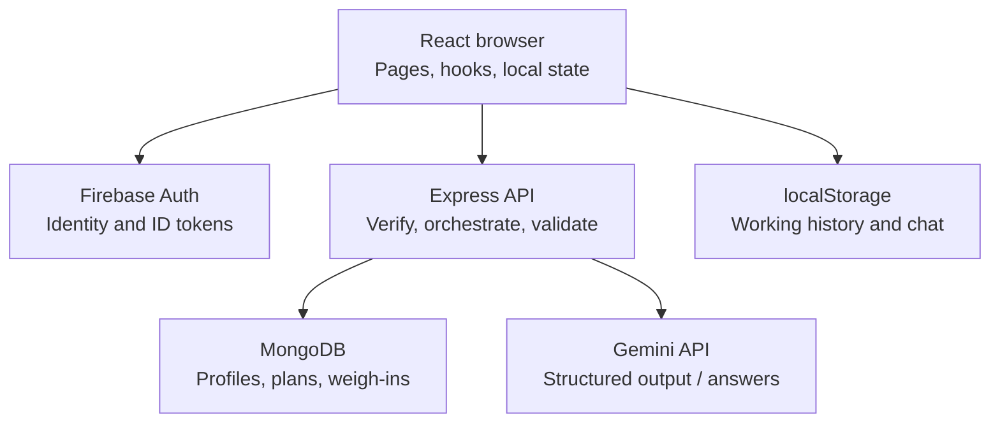
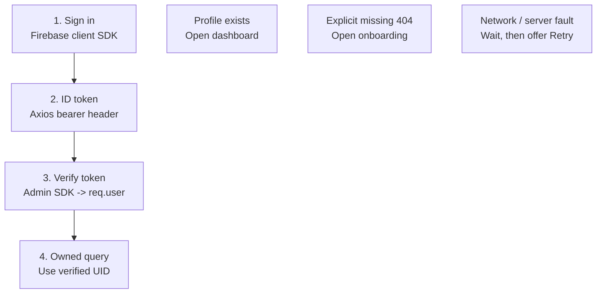
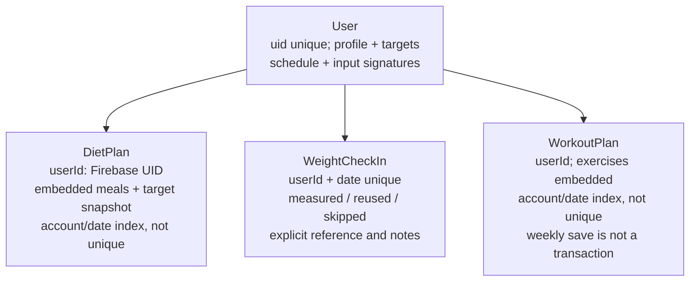
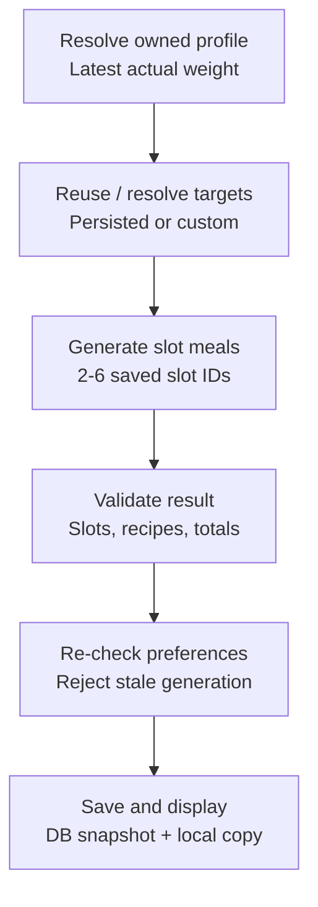
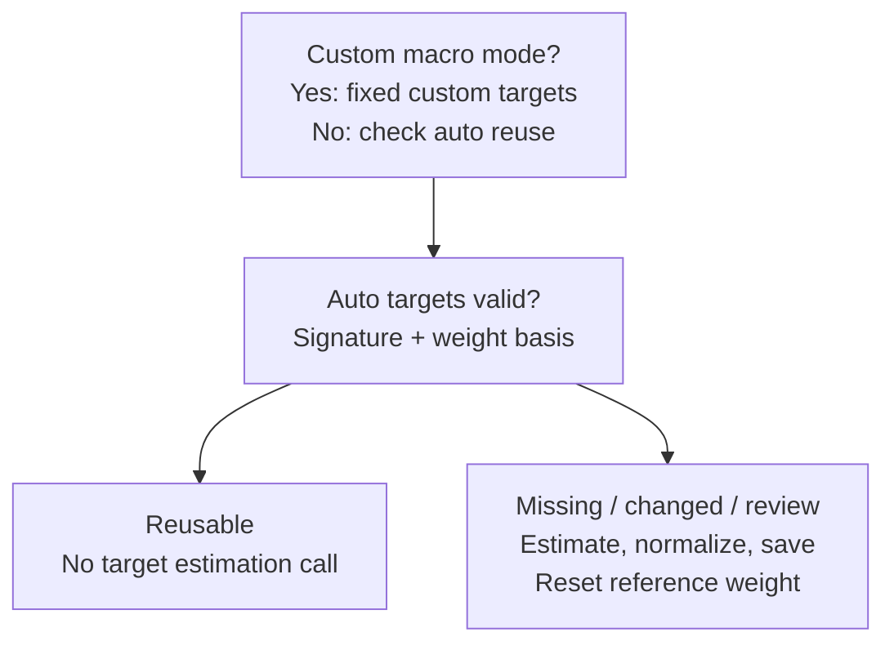
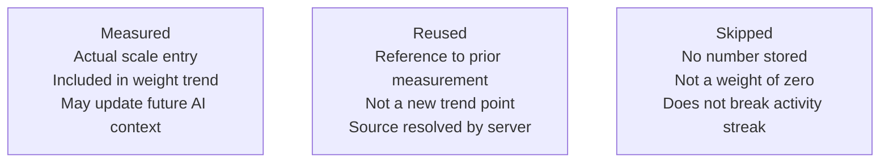
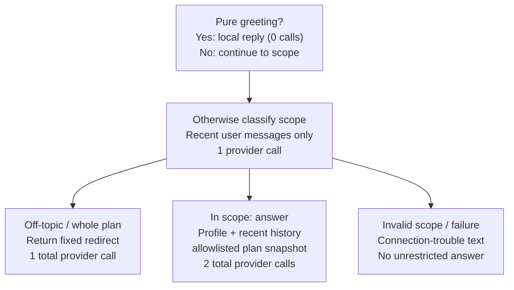
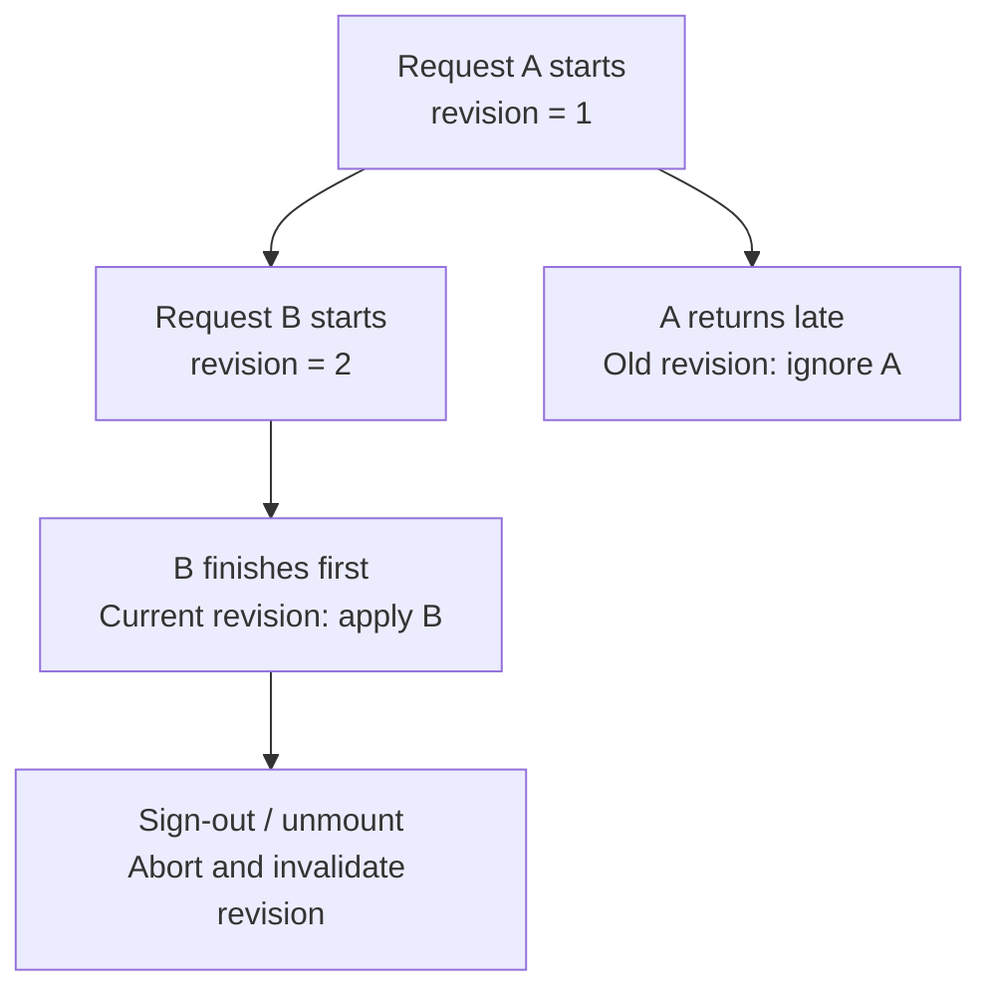
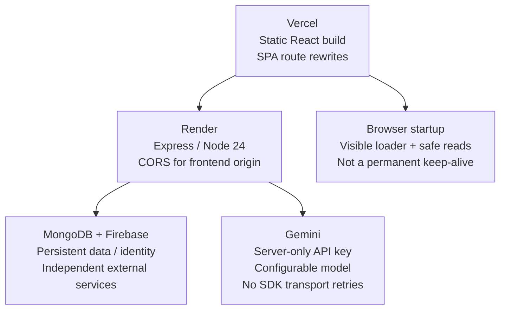

# AI Guruji - Own the Code

Visual study guide. Audited 8 November 2026; source `16c4932`.

[Visual PDF](../output/pdf/AI-Guruji-Interview-Guide.pdf) | [Searchable study companion](interview/index.html)

## Reading map

1. How to use this guide
2. A seven-day preparation plan
3. Your project story and AI-assisted ownership
4. The whole system in one picture
5. Your source-code navigation map
6. Authentication: prove who owns a request
7. Routes, startup and the cold-start loader
8. The data model and its guarantees
9. Persistence: the most important tradeoff
10. React state: the concepts you must explain
11. Nutrition: understand the full pipeline
12. When should nutrition targets change?
13. Meal schedules: three identities, three jobs
14. Validation: a worked nutrition example
15. Generate a daily menu: trace the code
16. Swaps and rebuilds must preserve history
17. Training: explain the weaker path too
18. Progress: measured, reused and skipped
19. Numbers, charts and calendar days
20. The chatbot is a trainer follow-up channel
21. Prompts, context and safe presentation
22. Gemini integration: know the exact boundary
23. Asynchronous code and concurrency
24. Deployment and configuration
25. Security review: controls and gaps
26. Limitations and the next sensible iteration
27. Testing: explain what the evidence means
28. Debugging drill: blank page or wrong onboarding
29. Debugging drill: wrong meals, totals or dates
30. Coding practice: pure functions first
31. Coding practice: boundary and concurrency tasks
32. React and browser fundamentals
33. HTTP, backend and databases
34. Nutrition, identity and validation
35. AI integration and provider failures
36. Scale, reliability and judgment
37. A realistic 25-minute mock interview
38. Your demo and CV checklist
39. Last-minute revision: twelve invariants
40. Glossary: browser and API language
41. Glossary: data and AI language
42. Code-reading checkpoints
43. Verified source references 1
44. Verified source references 2
45. Verified source references 3
46. Keep the notes accurate as the code changes

## 01. How to use this guide

*START HERE - Build understanding you can demonstrate without reading a script.*

### What this is

A source-based study guide for AI Guruji at commit 16c4932, audited on 8 November 2026. It explains the current Gemini implementation, reusable targets and personalized schedules. Earlier Groq, fixed-four-meal and light-theme descriptions in historical notes are superseded.

### Three passes

| Pass | What to do | Proof you understand |
| --- | --- | --- |
| 1. Map | Read architecture, authentication and storage pages. Draw the system from memory. | Name every network boundary and data owner. |
| 2. Trace | Follow one meal request, one weigh-in and one chat from button to response. | Open the source at the references and explain each step. |
| 3. Change | Solve the coding exercises in a practice branch; run the relevant tests. | Make a small change, explain failure cases, and test it. |

### Study rule

Read an answer once, close it, explain it aloud in your own words, then reopen the exact source. Memorize invariants and flows before memorizing filenames. If you cannot explain a line, turn it into a question.

### Verification boundary

This audit ran 19 client tests, 54 backend tests and a production client build successfully under Node 24.13.0. Provider tests mock HTTP. No paid model requests, real-account changes, deployed load tests or live end-to-end sign-in were performed for these notes.


## 02. A seven-day preparation plan

*LEARNING PLAN - Use the project as a practical full-stack course.*

### Daily route: about 90-120 minutes

| Day | Study | Practice aloud / in code |
| --- | --- | --- |
| 1 | Architecture, source map, persistence | Draw five components and explain browser vs server data. |
| 2 | React state, auth, routing and startup | Trace loading -> user/profile -> dashboard or onboarding. |
| 3 | Targets, schedules and validation | Calculate a macro example; reject a shortfall and a duplicate slot. |
| 4 | Generation, swap and async races | Trace a meal rebuild while preserving consumed calories. |
| 5 | Progress, training and chat | Explain measured/reused/skipped; count chat model calls. |
| 6 | Security, deployment and testing | Diagnose 401, 429, 503, a stale menu and a lost browser cache. |
| 7 | Mock interview and live edits | Give a two-minute demo, answer follow-ups, solve two exercises. |

### Use a four-point mastery scale

- 0: I recognize the term but cannot explain it.
- 1: I can describe the idea with notes.
- 2: I can trace it in this code without notes.
- 3: I can change it safely and write a test that would catch a regression.

### When you are ready to call this your main project

Aim for level 3 in authentication ownership, nutrition validation, browser/server persistence and the chatbot pipeline. Do not claim expertise in every library simply because it appears in package.json.


## 03. Your project story and AI-assisted ownership

*RECRUITER CONVERSATION - Present the work honestly, with specific evidence.*

### A 45-second project explanation

"AI Guruji is a personal fitness companion focused on Indian food preferences and practical routines. Users save their goals, generate daily meal plans and weekly workouts, log food and movement, track optional weigh-ins, and ask short follow-up questions about their plans. React handles the experience, Express handles authenticated orchestration, Firebase identifies users, MongoDB stores profiles and key records, and Gemini generates structured plans and coach replies. A major engineering challenge is validating AI output and preserving the user's recorded history when plans change."

### If asked how much AI wrote

"A substantial part of the implementation was AI-assisted. I am not claiming I typed every line manually. My responsibility is to understand the design, verify behavior and maintain it. I can walk through the authentication boundary, the target-validation pipeline, the storage tradeoffs and a change with tests." Use the last sentence only after you can actually demonstrate it.

### Evidence to bring

- Trace one request in the source instead of naming technologies only.
- Explain one limitation before the interviewer discovers it.
- Show a regression test and why it matters.
- Distinguish a feature you requested/reviewed from a line of code you personally authored.

### CV wording you can adapt

"Developed an AI-assisted personal fitness application using React, Express, MongoDB, Firebase Authentication and Gemini, with validated nutrition planning, optional weight tracking and scoped trainer follow-ups." Add test counts only with a date/snapshot. Do not invent usage, accuracy, latency, uptime or weight-loss metrics.


## 04. The whole system in one picture

*ARCHITECTURE - Explain the system before explaining individual components.*



The browser never receives the Gemini server key. Firebase identifies the user; MongoDB owns app records. Browser working history is a separate persistence path.

### Why these responsibilities are separated

The browser renders screens and maintains a working journal. Express is the place to verify tokens, choose the owned database record, call the model and validate results before saving. Firebase is the identity service; it is not the fitness database. The model is an external dependency, not a database or an authorization engine.

### Why a monolith is reasonable here

There are two independent npm packages, not separate microservices for every feature. This keeps deployment and debugging manageable for a personal project. Services and pure contracts separate domain logic without adding network hops.

### Say it precisely

This is an API-backed React single-page application with server-side AI orchestration. It is not a trained-from-scratch model, a vector-search/RAG system, or an autonomous tool-using agent.

**Open the code:**
- [client/src/main.jsx:6](../client/src/main.jsx) - React mount and StrictMode
- [backend/src/server.js:8](../backend/src/server.js) - Server startup order
- [backend/src/services/deepseekService.js:32](../backend/src/services/deepseekService.js) - Gemini interaction configuration and errors
- [client/src/components/Dashboard.jsx:83](../client/src/components/Dashboard.jsx) - UID/date working caches


## 05. Your source-code navigation map

*CODE TOUR - Know where to look instead of scanning the whole repository.*

### Follow the responsibility

| Area | Start here | What it owns |
| --- | --- | --- |
| Client boot | main.jsx -> App.jsx -> AppRouter.jsx | React root, auth provider, route decisions |
| Identity | contexts/AuthContext.jsx; services/api.js | Session, profile load, bearer token |
| Daily experience | components/Dashboard.jsx | Working plans, completion, local journals |
| Nutrition | nutritionProfileService.js; nutritionTargets.js | Reusable targets, refresh rules, arithmetic |
| AI boundary | geminiClient.js; deepseekService.js | SDK transport, prompts, parsing, fallbacks |
| Shared contract | client/src/contracts + backend/src/contracts | Schedule and signature parity |
| Progress | progressController.js; useProgress.js | Owned weight journal and save state |
| Presentation | DietCard, WorkoutCard, Progress, ChatMessage | Rendering, interactions, safe formatted text |

### Read in this order for an unfamiliar feature

- UI event -> backendService helper -> Express route -> verifyToken -> controller -> domain service/model -> response -> state/cache update.
- Read docs/ARCHITECTURE.md as an index. Read current source before answering; historical migration notes may describe obsolete behavior.
- The file name deepseekService.js is historical. The actual provider adapter imports Gemini.

**Open the code:**
- [client/src/AppRouter.jsx:19](../client/src/AppRouter.jsx) - Route guards and profile redirects
- [backend/src/controllers/dietController.js:11](../backend/src/controllers/dietController.js) - Authenticated menu pipeline/coalescing
- [backend/src/services/deepseekService.js:264](../backend/src/services/deepseekService.js) - Greeting, scope and answer pipeline
- [client/src/hooks/useProgress.js:12](../client/src/hooks/useProgress.js) - Progress state and request revisions


## 06. Authentication: prove who owns a request

*CORE WALKTHROUGH - Separate identity, authorization and profile existence.*



After the owned profile read, these are three different outcomes. A 500, HTML response or timeout is never evidence that a profile is absent.

Source excerpt: `backend/src/middlewares/authMiddleware.js:11`

```javascript
        const decodedToken = await verifyIdToken(token);
        req.user = {
            uid: decodedToken.uid,
            email: decodedToken.email,
        };
        next();
    } catch (error) {
        console.error('Token verification error:', error.message);
        res.status(401).json({ error: 'Invalid or expired token' });
```

### Explain the boundary

The Firebase client signs the person in. Axios obtains an ID token and puts it in Authorization: Bearer. The Admin SDK verifies it on the server, and controllers use req.user.uid for ownership. A body field named uid or userId is not proof of identity. The frontend route guard improves navigation; it does not protect the API by itself.

### Important security-review exception

The intended rule is verified ownership. The workout save currently spreads generated day fields after ownership/date fields; that weaker boundary needs an explicit allowlist and server-owned fields assigned last. Do not claim every write is immune to ownership override.

**Open the code:**
- [client/src/services/api.js:9](../client/src/services/api.js) - Client bearer-token injection
- [backend/src/middlewares/authMiddleware.js:11](../backend/src/middlewares/authMiddleware.js) - Verified server identity
- [backend/src/controllers/userController.js:18](../backend/src/controllers/userController.js) - Profile write allowlist
- [backend/src/controllers/workoutController.js:13](../backend/src/controllers/workoutController.js) - Weekly save/date and spread caveats


## 07. Routes, startup and the cold-start loader

*RELIABILITY - A slow backend is a different state from a new user.*

### Observed state -> UI decision

| State | Current response |
| --- | --- |
| Auth/profile read pending | Show StartupScreen; never hide all provider children. |
| No Firebase user | Show public landing/auth; start one bounded anonymous warm-up. |
| Owned profile loaded | Open dashboard; existing profile has view mode and a separate editor. |
| Exact missing profile 404 | Allow onboarding at /profile. |
| Network, 5xx, invalid HTML/profile | Retry safe reads, then show connection error with Retry. |
| Public /how-it-works | Accessible while session/profile loading or errors continue. |

### Know the actual limits

Profile/readiness reads have a 120-second total window, 15-second attempt limits and 2.5-second gaps. Initial Firebase restoration has a separate 20-second timeout. AbortController and revision checks stop an old session from updating a new one. This is not a permanent keep-alive and does not prevent the host from sleeping.

### Why reads and writes differ

A safe profile/readiness GET can be attempted again. Replaying a plan-generation POST could incur model cost and save extra snapshots. The startup helper does not globally retry writes, swaps or chat.

### Health is deliberately limited

/api/health is public, no-store JSON: 200 ready or 503 starting. It checks MongoDB connection and Firebase Admin initialization, not Gemini quota, model access or every database operation.

**Open the code:**
- [client/src/contexts/AuthContext.jsx:18](../client/src/contexts/AuthContext.jsx) - Auth session, abort and revision lifecycle
- [client/src/utils/backendStartup.js:43](../client/src/utils/backendStartup.js) - Bounded safe-read retries
- [client/src/utils/backendStartup.js:64](../client/src/utils/backendStartup.js) - Strict missing-profile interpretation
- [backend/src/controllers/healthController.js:4](../backend/src/controllers/healthController.js) - Anonymous readiness
- [client/src/AppRouter.jsx:19](../client/src/AppRouter.jsx) - Route guards and profile redirects


## 08. The data model and its guarantees

*DATABASE DESIGN - Explain why indexes and document structure matter.*



These are logical relationships using the Firebase UID string, not automatic ObjectId foreign keys. ChatHistory also has a schema/read endpoint, but message sends do not persist it.

### Index distinction

| Record | What is actually guaranteed |
| --- | --- |
| User.uid | Unique application profile per Firebase UID. |
| WeightCheckIn(userId,date) | Unique date entry per user; changing a check-in replaces that date. |
| DietPlan / WorkoutPlan account+date | Query index only, not uniqueness. Multiple snapshots can exist. |
| ChatHistory | Model/read endpoint exists; sendMessage does not write conversation history. |

### Embedding versus references

Meals and exercises are embedded in plan documents because they belong to a generated snapshot and are commonly read together. User linkage is a string UID. Mongoose provides schemas and queries, but an ordinary index does not create referential integrity or make a multi-document write transactional.

**Open the code:**
- [backend/src/models/User.js:5](../backend/src/models/User.js) - Profile and target persistence
- [backend/src/models/WeightCheckIn.js:10](../backend/src/models/WeightCheckIn.js) - Unique account/date weight journal
- [backend/src/controllers/dietController.js:11](../backend/src/controllers/dietController.js) - Authenticated menu pipeline/coalescing
- [backend/src/controllers/workoutController.js:13](../backend/src/controllers/workoutController.js) - Weekly save/date and spread caveats
- [backend/src/controllers/chatController.js:6](../backend/src/controllers/chatController.js) - Chat response without history write


## 09. Persistence: the most important tradeoff

*DATA OWNERSHIP - Know what survives a different browser or cleared storage.*

### Current ownership map

| Data | Where it lives | Cross-device consequence |
| --- | --- | --- |
| Firebase identity | Firebase Authentication | Sign in on another browser. |
| Profile, targets, schedule | MongoDB User | Account-owned and reusable. |
| Generated plan snapshots | MongoDB plus browser working copy | DB history exists; dashboard does not hydrate it. |
| Completion, manual logs, local swaps | UID/date-scoped localStorage | Working activity does not currently sync. |
| Coach conversation | Per-user browser localStorage | Sending does not persist ChatHistory. |
| Weights and cadence | MongoDB WeightCheckIn / User | Retrieved through protected progress API. |

Source excerpt: `client/src/components/Dashboard.jsx:83`

```javascript
  const getDietKey = date => `aiCoachDiet_${user.uid}_${date}`;
  const getWorkoutKey = date => `aiCoachWorkout_${user.uid}_${date}`;
  const getTrackingKey = date => `aiCoachTracking_${user.uid}_${date}`;
  const getManualMealsKey = date => `aiCoachManualMeals_${user.uid}_${date}`;
  const getManualWorkoutsKey = date => `aiCoachManualWorkouts_${user.uid}_${date}`;
  const getChatKey = () => `aiCoachChat_${user.uid}`;
```

### Answer the two-device question honestly

A second device can recover the profile and weight journal, but it cannot reconstruct local completion, manual logs, swaps or the browser conversation. Clearing local cache can trigger generation again even though a plan snapshot is stored in MongoDB. Synchronizing this requires owned journal endpoints plus explicit merge/version semantics; it is not solved by merely adding a history GET.

### Namespacing is not authorization

A UID in a localStorage key prevents accidental mixing in normal app reads. It does not encrypt the data, protect it from XSS, or remove prior account data on logout.

**Open the code:**
- [client/src/components/Dashboard.jsx:83](../client/src/components/Dashboard.jsx) - UID/date working caches
- [backend/src/controllers/chatController.js:6](../backend/src/controllers/chatController.js) - Chat response without history write
- [client/src/utils/progressData.js:15](../client/src/utils/progressData.js) - Measured-only trends


## 10. React state: the concepts you must explain

*FRONTEND FUNDAMENTALS - Connect hooks and immutability to a real bug class.*

### State versus derived values

Dashboard owns working day state and passes data/callbacks to cards. useState triggers a render; useRef holds mutable bookkeeping without causing one; useEffect synchronizes external work and returns cleanup; useCallback stabilizes a function for specified dependencies. Derived values such as burnedToday should come from current inputs rather than a second unsynchronized copy.

Source excerpt: `client/src/components/Dashboard.jsx:362`

```javascript
  const addManualWorkout = workout => {
    const updatedWorkouts = [...currentManualWorkouts, workout];
    setManualWorkoutsHistory(prev => ({
      ...prev,
      [selectedDate]: updatedWorkouts
    }));
    localStorage.setItem(getManualWorkoutsKey(selectedDate), JSON.stringify(updatedWorkouts));
    const completedExerciseIds = [...currentTracking.completedExerciseIds, workout.id];
    const burned = computeBurnedToday(currentWorkoutPlan, updatedWorkouts, completedExerciseIds);
    saveTracking({
      ...currentTracking,
      completedExerciseIds,
      totalEstimatedCaloriesBurned: burned,
      netCalories: currentTracking.totalEstimatedCaloriesConsumed - burned
```

### Why the extended array matters

A state setter schedules a future render; it does not mutate the current closure. addManualWorkout computes burn from updatedWorkouts immediately, instead of calling a helper that still sees the old array. Completion IDs, burn and net energy are saved together. For updates based only on previous state, a functional setter such as setItems(old => [...old, item]) avoids capturing an outdated array.

### Likely follow-ups

- Why are arrays copied instead of mutated? New references make updates predictable and avoid hidden shared mutation.
- Why does StrictMode expose duplicate effects? Development replay reveals missing cleanup and duplicate side effects; it is not a reason to remove StrictMode.
- Why a custom hook? useProgress and useNutritionProfile isolate async state/lifecycle logic from rendering. They are not globally shared state just because they are hooks.

**Open the code:**
- [client/src/components/Dashboard.jsx:362](../client/src/components/Dashboard.jsx) - Avoiding stale burn totals
- [client/src/hooks/useProgress.js:12](../client/src/hooks/useProgress.js) - Progress state and request revisions
- [client/src/hooks/useNutritionProfile.js:17](../client/src/hooks/useNutritionProfile.js) - Client coalescing and stale-result protection


## 11. Nutrition: understand the full pipeline

*CORE WALKTHROUGH - Separate target estimation, menu construction and validation.*



The server is the correctness boundary even if client target ensure and menu generation start concurrently. A completed invalid response can receive one correction; transport failures cannot.

### Two different model jobs

Auto target estimation decides reusable daily numeric targets from the saved goal/body/activity inputs and latest actual weight. Menu generation constructs meals for the saved schedule using those fixed targets. A new day normally needs a new menu, not a fresh target estimate. Custom macros skip target estimation entirely.

### The server remains authoritative

The client can ensure target state through useNutritionProfile while a generation request is also starting. Both paths reach server-side target resolution. Client readiness, disabled buttons and displayed totals are useful UX, but only server validation decides whether a generated plan is eligible for saving.

### What makes this more than a prompt wrapper

The application adds owned profile lookup, target persistence, schedule identity, arithmetic checks, bounded correction, stale-profile checks, worker-local coalescing, local journaling and explicit rebuild behavior around the model call.

**Open the code:**
- [client/src/hooks/useNutritionProfile.js:17](../client/src/hooks/useNutritionProfile.js) - Client coalescing and stale-result protection
- [backend/src/services/nutritionProfileService.js:11](../backend/src/services/nutritionProfileService.js) - Persisted target reuse and update
- [backend/src/controllers/dietController.js:11](../backend/src/controllers/dietController.js) - Authenticated menu pipeline/coalescing
- [backend/src/services/dietPlanValidation.js:20](../backend/src/services/dietPlanValidation.js) - Meal-slot and recipe validation
- [backend/src/services/deepseekService.js:106](../backend/src/services/deepseekService.js) - One correction of completed invalid output


## 12. When should nutrition targets change?

*DOMAIN DECISIONS - Defend reuse and refresh rules with numbers.*



Custom targets do not need target estimation. In auto mode, valid targets are reused unless inputs change, an explicit review is requested, or the configured weight threshold is reached.

### Worked example: cumulative weight change

Suppose the saved target basis is 80 kg and the threshold is 5%. A measurement of 76.1 kg differs by 3.9/80 = 4.875%, so the current targets can remain. At 76.0 kg the absolute difference is 5%, so auto targets need review on the next resolve. Compare with the saved basis, not only yesterday: small cumulative changes can eventually cross the threshold. A successful refresh resets the basis.

### Signatures have different jobs

targetInputKey includes age, gender, height, goal, activity, macro mode and custom grams. Weight is handled separately. nutritionProfileKey also includes the schedule and food/preferences/allergies/region/budget/notes. Name/email changes do not invalidate nutrition. The signature is JSON serialization for comparison, not a cryptographic signature or an authorization mechanism.

### Custom targets and concurrency

Custom grams remain authoritative even after a large weight change. Conditional User writes prevent selected stale profile updates, but the filters are not a full transaction or a guarantee against every concurrent new weigh-in race.

**Open the code:**
- [backend/src/contracts/nutrition.js:50](../backend/src/contracts/nutrition.js) - Cumulative weight-change rule
- [backend/src/contracts/nutrition.js:32](../backend/src/contracts/nutrition.js) - Target and menu signatures
- [backend/src/services/nutritionProfileService.js:11](../backend/src/services/nutritionProfileService.js) - Persisted target reuse and update
- [backend/src/services/nutritionProfileService.js:37](../backend/src/services/nutritionProfileService.js) - Conditional target write


## 13. Meal schedules: three identities, three jobs

*DATA CONTRACTS - Never use meal type as a unique identity.*

### Do not confuse these fields

| Field | Example | Purpose |
| --- | --- | --- |
| type | snack | Category; repeats are allowed. |
| slotId | morning-snack | Stable place in the saved schedule. |
| id | generated meal identifier | Specific meal instance used by completion tracking. |
| label / time | Morning snack / 11:00 | User-facing meaning and optional schedule time. |

### Current contract

A saved schedule contains 2-6 slots. Slot IDs must be distinct lowercase alphanumeric/hyphen strings; labels must be nonempty and at most 50 characters; optional time is validated as HH:MM. A generated menu must contain exactly one meal per slot and must preserve schedule order. Two snacks remain independent because their slot IDs differ.

Source excerpt: `backend/src/services/dietPlanValidation.js:20`

```javascript
export const normalizeDietPlan = (plan, requiredTargets, requiredSchedule) => {
    const schedule = normalizeMealSchedule(requiredSchedule || plan?.mealSchedule);
    const legacy = !requiredSchedule && !plan?.mealSchedule;
    if (!Array.isArray(plan?.meals) || plan.meals.length !== schedule.length) throw new Error(`A daily plan must include exactly ${schedule.length} scheduled meals`);
    const seen = new Set();
    const meals = plan.meals.map(meal => {
        const slot = schedule.find(slot => meal.slotId ? slot.id === meal.slotId : legacy && slot.type === String(meal.type).toLowerCase());
        if (!slot || seen.has(slot.id)) throw new Error('A daily plan must contain each scheduled meal exactly once');
        seen.add(slot.id);
        const normalized = normalizeMeal(meal, slot.type);
        return { ...normalized, slotId: slot.id, label: slot.label, time: slot.time };
    });
```

### Backward compatibility

Old plans without a saved schedule use the default four-slot mapping. Presentation keeps extra old meals readable. Historical cards use their own saved schedule and targets, not the current profile preferences. Rebuilding the current menu is explicit.

### Why mirror the contract?

Client and backend each deploy from their own package root. Pure contract copies keep each package self-contained; a behavioral parity test detects drift. A future shared versioned package is an option, not the current architecture.

**Open the code:**
- [backend/src/contracts/nutrition.js:18](../backend/src/contracts/nutrition.js) - Personal schedule contract
- [backend/src/contracts/nutrition.js:56](../backend/src/contracts/nutrition.js) - Legacy and repeated-slot presentation
- [backend/src/contracts/nutrition.js:32](../backend/src/contracts/nutrition.js) - Target and menu signatures


## 14. Validation: a worked nutrition example

*ARITHMETIC - Explain what validation proves and what it cannot prove.*

### Example fixed targets, for software arithmetic only

| Quantity | Example target | Acceptance rule |
| --- | --- | --- |
| Calories | 2,000 kcal | 1,800 to 2,200 kcal |
| Protein | 150 g | 150 to 172.5 g; no shortfall |
| Carbohydrate | 225 g | 191.25 to 258.75 g |
| Fat | 56 g | 47.6 to 64.4 g |

### Energy consistency

The example macro energy is 150*4 + 225*4 + 56*9 = 2,004 kcal, consistent with a 2,000 kcal target. A meal containing 40 g protein, 50 g carbs and 15 g fat implies 495 kcal. If it declares 500 kcal, the difference is 1% of the declared calories, within the meal-level 15% check. These are illustrative arithmetic values, not a recommended diet.

### A valid shape can still be wrong

JSON schema checks structure/types. The domain validator additionally checks scheduled slot completeness, distinctness, recipes, finite nutrition values, daily totals and per-meal macro energy. A plan with 149 g protein fails a 150 g minimum even if its calories are perfect. totalCalories is derived from meals rather than accepted independently.

### Do not overclaim nutritional accuracy

The checks establish internal consistency and target bounds, not truthful ingredient nutrition, allergen exclusion or clinical suitability. The app has no verified food-composition database or deterministic allergen engine.

**Open the code:**
- [backend/src/services/nutritionTargets.js:33](../backend/src/services/nutritionTargets.js) - Daily macro and meal energy validation
- [backend/src/services/nutritionTargets.js:16](../backend/src/services/nutritionTargets.js) - Custom macro energy
- [backend/src/services/dietPlanValidation.js:20](../backend/src/services/dietPlanValidation.js) - Meal-slot and recipe validation


## 15. Generate a daily menu: trace the code

*REQUEST WALKTHROUGH - Follow the owned request all the way to the working cache.*

### Button to response

- Dashboard calls generateDietPlan(), which POSTs /api/diet/generate without trusting a client-supplied profile.
- verifyToken sets req.user. createDietPlan resolves that UID's profile/targets and forms a pending-plan key from UID, UTC day, profile signature and fixed targets.
- Gemini receives profile data, the fixed targets and the exact saved meal slots. Completed text is parsed and domain-validated.
- Before saving, the controller reads the current profile and rejects a mismatching menu signature/target set.
- DietPlan.create saves a snapshot. Dashboard caches a dated working copy, initializes tracking if missing and refreshes target profile state.

Source excerpt: `backend/src/controllers/dietController.js:11`

```javascript
export const createDietPlan = async (req, res) => {
    const uid = req.user.uid;
    const date = new Date().toISOString().split('T')[0];
    let key, operation;
    try {
        const { profile, effective } = await resolveNutritionProfile(uid);
        const profileKey = nutritionProfileKey(profile);
        key = JSON.stringify([uid, date, profileKey, profile.nutritionTargets]);
        operation = pendingPlans.get(key);
        if (!operation) {
            operation = (async () => {
                const plan = await generateDietPlan(effective, profile.nutritionTargets);
                plan.nutritionProfileKey = profileKey;
```

### What coalescing means

Simultaneous matching requests in one Node worker await the same Promise. This reduces duplicate estimation/menu calls during concurrent requests and development effect replay. The entry is removed in finally. It is not permanent caching, a distributed lock, global idempotency, or a unique account/day database constraint.

### Failure behavior

A failed target estimate/menu leaves prior saved targets or the working menu intact. Nutrition provider rate errors propagate as 429; availability/configuration errors as 503. A stale-profile conflict is 409. Do not label all failures as missing profile.

**Open the code:**
- [backend/src/controllers/dietController.js:11](../backend/src/controllers/dietController.js) - Authenticated menu pipeline/coalescing
- [backend/src/services/nutritionProfileService.js:11](../backend/src/services/nutritionProfileService.js) - Persisted target reuse and update
- [backend/src/services/deepseekService.js:106](../backend/src/services/deepseekService.js) - One correction of completed invalid output


## 16. Swaps and rebuilds must preserve history

*STATE INVARIANTS - Do not erase what the user already consumed.*

### One-meal swap

The browser sends the current meal plus the working plan. The server reads the owned profile, checks current signature/targets when a plan is supplied, and validates the replacement in the whole-day context. A snack replacement must retain that exact slot ID; another snack is left alone. A new meal instance ID allows distinct completion tracking. The browser recalculates plan calories and tracking targets. The swap does not update the saved MongoDB snapshot.

Source excerpt: `client/src/utils/mealPlanReplacement.js:2`

```javascript
export function retainLoggedMeals(previousPlan, journal, tracking, nextPlan) {
  const journalIds = new Set(journal.map(meal => meal.id));
  const completed = new Set(tracking.completedMealIds);
  const retained = (previousPlan?.meals || []).filter(meal => completed.has(meal.id) && !journalIds.has(meal.id)).map(meal => ({ ...meal, source: 'manual', timeOfDay: meal.type }));
  return {
    journal: [...journal, ...retained],
    tracking: { ...tracking, totalTargetCalories: nextPlan.totalCalories, calorieDeficit: nextPlan.totalCalories - tracking.totalEstimatedCaloriesConsumed }
  };
}
```

### Worked rebuild example

A user logged breakfast (460 kcal) and lunch (610 kcal), so consumed energy is 1,070 kcal. They now change five scheduled meals to three and explicitly rebuild. retainLoggedMeals moves completed old planned meals into the manual journal using the original IDs, deduplicating against existing manual entries. Consumed energy, completed IDs and movement history remain; the new target comes from the new menu. Unlogged old meals are not fabricated as eaten.

### What to test

Repeated snack slots, a swap that drops protein below the daily target, stale profile signatures, a rebuilt day with old completed food, duplicate retained IDs and failure leaving the original menu untouched.

**Open the code:**
- [client/src/components/Dashboard.jsx:296](../client/src/components/Dashboard.jsx) - Swap replacement and tracking totals
- [client/src/utils/mealPlanReplacement.js:2](../client/src/utils/mealPlanReplacement.js) - Preserving consumed food across rebuilds
- [backend/src/services/dietPlanValidation.js:20](../backend/src/services/dietPlanValidation.js) - Meal-slot and recipe validation
- [client/src/utils/nutritionPlan.js:3](../client/src/utils/nutritionPlan.js) - Outdated cached-menu detection


## 17. Training: explain the weaker path too

*CORE WALKTHROUGH - A truthful project explanation includes uneven maturity.*

### Happy path

The client requests a week starting on the selected date. The prompt asks for seven chronological days, meaningful session focus and appropriate recovery days. The service parses weekPlan, assigns exercise IDs and uses the focus or dayName. The controller saves each returned day with Promise.all; the client assigns consecutive dates by array position and caches each day.

Source excerpt: `backend/src/controllers/workoutController.js:13`

```javascript
        const savedPlans = await Promise.all(weekPlan.map(day =>
            WorkoutPlan.create({
                userId: req.user.uid,
                date: new Date().toISOString().split('T')[0], 
                ...day
            })
        ));

        res.json(savedPlans);
```

### Current limitations you should be ready to discuss

- The controller stamps the same UTC today date on each entry unless a spread day overrides it. The browser corrects display dates locally; database history dates still need a real fix.
- Promise.all is concurrent, not a transaction. A partial save can survive if another write fails.
- Workout structure/date ordering has weaker domain validation than nutrition. Generated day fields are spread after userId/date, so assign server-owned fields last and allowlist output.
- Provider failure returns a static beginner week with no explicit fallback marker. This must not be presented as a successful personalized generation.

### Recovery versus missing data

An actual saved session with an empty exercises array can represent recovery. A missing saved plan means unknown/no data, not automatically a recovery day or a missed workout.

**Open the code:**
- [backend/src/controllers/workoutController.js:13](../backend/src/controllers/workoutController.js) - Weekly save/date and spread caveats
- [backend/src/services/deepseekService.js:234](../backend/src/services/deepseekService.js) - Workout generation and fallback
- [client/src/components/Dashboard.jsx:118](../client/src/components/Dashboard.jsx) - Browser generation and rebuild


## 18. Progress: measured, reused and skipped

*CORE WALKTHROUGH - Keep an honest record of what is known.*



Sparse measurements remain sparse. Activity streaks use logged meals/movement, not whether a person shared weight.

Source excerpt: `backend/src/controllers/progressController.js:28`

```javascript
        const filter = { userId: req.user.uid, date: entry.date };
        const update = { $set: { ...entry, userId: req.user.uid } };
        let saved;
        try {
            saved = await WeightCheckIn.findOneAndUpdate(filter, update, { new: true, upsert: true, runValidators: true });
        } catch (error) {
            if (error.code !== 11000) throw error;
            saved = await WeightCheckIn.findOneAndUpdate(filter, update, { new: true, runValidators: true });
        }
        res.json(saved);
    } catch { res.status(500).json({ error: 'Your check-in couldn’t be saved. Please try again.' }); }
};
export const saveProgressPreferences = async (req, res) => {
```

### Why the write is robust

The ownership filter is built from req.user.uid plus the validated date. A compound unique index enforces one check-in per account/date; upsert inserts or replaces it. On duplicate-key error 11000 from an insertion race, the controller repeats the update without upsert. A reused entry is resolved from the latest earlier actual measurement on the server, ignoring any browser-supplied weight/source.

### Future personalization

withLatestWeight overlays the latest measured weight in transient AI context and leaves the profile baseline intact. It excludes future, reused and skipped entries. A new measurement can inform target review; it does not automatically replace a menu the user already logged.

**Open the code:**
- [backend/src/models/WeightCheckIn.js:10](../backend/src/models/WeightCheckIn.js) - Unique account/date weight journal
- [backend/src/controllers/progressController.js:28](../backend/src/controllers/progressController.js) - Owned atomic check-in upsert
- [backend/src/services/profileContextService.js:6](../backend/src/services/profileContextService.js) - Latest actual measurement in AI context
- [client/src/utils/progressData.js:15](../client/src/utils/progressData.js) - Measured-only trends


## 19. Numbers, charts and calendar days

*CALCULATION WALKTHROUGH - Explain formulas without confusing them with health outcomes.*

### Current calculation

| Name | Meaning / example |
| --- | --- |
| Consumed | Sum of logged meal energy. Example: 460+610 = 1,070 kcal. |
| Burned | Estimated energy for completed exercises/manual movement. |
| Net energy | Consumed - burned. 1,070 - 165 = 905 kcal. |
| calorieDeficit field | Target - consumed. 1,900 - 1,070 = 830; does not subtract burn. |
| Weight change | Latest actual measurement - first actual in selected range. |
| Activity streak | Consecutive days with a meal/exercise log; an empty today can be skipped. |

### Manual movement is an estimate

The modal uses round(minutes * intensityRate * weight/70), with rates 3.5, 7 and 11. Missing/invalid weight falls back to 70 kg. This is an app estimate, not wearable-measured expenditure or a clinical energy-balance engine. Unlogged days are unknown, not proof of non-adherence.

### The UTC trap

dayKey uses toISOString().slice(0,10). At 01:00 on 8 November in India, UTC is still 7 November. Some calendar helpers use UTC-safe day arithmetic while older dashboard loops use local setDate then ISO. A fix must cover cache keys, server dates, charts, history, migration and midnight rollover together; changing one formatter does not fix the data model.

### Trend honesty

weightSummary includes only actual measured points. Two actual observations are needed for a change. Reused values do not create extra points, and scale-weight change is not a body-fat measurement.

**Open the code:**
- [client/src/components/Dashboard.jsx:322](../client/src/components/Dashboard.jsx) - Meal completion arithmetic
- [client/src/components/Dashboard.jsx:362](../client/src/components/Dashboard.jsx) - Avoiding stale burn totals
- [client/src/utils/progressData.js:15](../client/src/utils/progressData.js) - Measured-only trends
- [client/src/utils/progressData.js:1](../client/src/utils/progressData.js) - UTC day keys and day arithmetic
- [client/src/utils/progressData.js:40](../client/src/utils/progressData.js) - Activity streak including an empty today


## 20. The chatbot is a trainer follow-up channel

*AI WALKTHROUGH - Explain the branches and their cost.*



The edge from greeting to classification means "if it is not a pure greeting". A scope gate limits answer scope, but still costs a classifier request and is not a rate limiter.

### Examples you should predict

| Message | Expected branch |
| --- | --- |
| hi | Deterministic short greeting; no provider request. |
| Can I replace paneer in lunch? | In scope; classify, then contextual answer. |
| Create a whole seven-day diet | Plan request; direct user to plan screens. |
| Write Python for my calorie tracker | Off topic, even though calories are fitness-related. |

### Why scope excludes old assistant replies

The classifier gets the latest message and up to four recent user messages truncated to 500 characters each. Saved profile data and assistant messages are excluded so an old fitness goal or strict response does not transform an unrelated request into a fitness task. Relevant answering then uses profile, recent conversation and summarized plan context.

**Open the code:**
- [backend/src/services/deepseekService.js:264](../backend/src/services/deepseekService.js) - Greeting, scope and answer pipeline
- [backend/src/services/chatScope.js:31](../backend/src/services/chatScope.js) - User-only bounded classifier context
- [backend/src/services/coachContext.js:8](../backend/src/services/coachContext.js) - Allowlisted browser plan context
- [client/src/components/ChatCoach.jsx:19](../client/src/components/ChatCoach.jsx) - Controlled conversation and transport


## 21. Prompts, context and safe presentation

*AI SAFETY BOUNDARIES - Distinguish useful controls from guarantees.*

### What is supplied to the answer model

The coach policy asks for short practical help about meals, exercise and recovery. Saved profile context excludes UID/email and includes relevant preferences and saved targets. The answer history is normalized to user/assistant roles and capped at 12 messages. Browser working-plan context is projected into bounded meal/exercise fields rather than passed through wholesale.

### A browser plan is advisory

The snapshot can include local swaps and incomplete data. summarizePlanContext keeps useful fields, trims text and bounds lists, and labels the data as a browser snapshot. It is not an authenticated server record and must not be interpreted as instructions. Missing meals stay unknown; an empty actual workout can mean recovery.

Source excerpt: `client/src/components/ChatMessage.jsx:12`

```javascript
export default function ChatMessage({ text }) {
  const lines = String(text || '').replace(/\r\n/g, '\n').split('\n');
  const blocks = [];
  for (let index = 0; index < lines.length;) {
    const line = lines[index].trim();
    if (!line || /^[-*_]{3,}$/.test(line)) { index++; continue; }
    const heading = line.match(/^#{1,6}\s+(.+)$/);
    if (heading) { blocks.push(<h4 key={index}>{inline(heading[1], `h-${index}`)}</h4>); index++; continue; }
    const list = line.match(/^(?:[-*+]\s+|\d+[.)]\s+)/);
```

### Why users do not see raw ** markers

ChatMessage converts a small Markdown subset into React elements: emphasis, code, headings, lists and paragraphs. It never evaluates raw HTML. React escapes ordinary strings, so text such as an img/onerror tag remains text. This is not a full Markdown/link/table renderer and not a claim that all possible XSS sources in the app have been audited.

### Scope is not credit-abuse prevention by itself

The classifier is model-based, may misclassify, and still costs a request. The project has no per-account rate limiter or hard budget system. A serious abuse-control layer needs those independent server-side controls.

**Open the code:**
- [backend/src/services/coachContext.js:8](../backend/src/services/coachContext.js) - Allowlisted browser plan context
- [backend/src/services/chatScope.js:31](../backend/src/services/chatScope.js) - User-only bounded classifier context
- [client/src/components/ChatMessage.jsx:12](../client/src/components/ChatMessage.jsx) - Escaped basic Markdown rendering
- [backend/src/controllers/chatController.js:6](../backend/src/controllers/chatController.js) - Chat response without history write


## 22. Gemini integration: know the exact boundary

*PROVIDER DESIGN - Explain configuration and failure behavior without exposing keys.*

### Current implementation

| Setting | Behavior |
| --- | --- |
| Adapter | geminiClient.js lazily creates GoogleGenAI; prompts stay in deepseekService.js. |
| Configured model | GEMINI_MODEL, default gemini-3.6-flash; provider availability is not verified here. |
| Server credential | GEMINI_API_KEY, then GOOGLE_API_KEY; never a VITE_ client secret. |
| Interaction style | Native user_input/model_output steps; store:false; no streaming or tools. |
| Transport | 60-second timeout; SDK retries strategy none. |
| Accepted result | Nonempty text only when response.status is completed. |
| Errors | 429 -> AI_RATE_LIMIT; credential/model access -> AI_CONFIGURATION; other failures -> AI_UNAVAILABLE. |

### Structured output is the first layer

JSON tasks request an application/json schema; nutrition/scope have explicit requirements, while workout uses a more generic object shape. Parsed output still needs domain validation. store:false is a request setting, not a blanket guarantee about a provider's total data-handling policy.

### One correction is not an automatic network replay

Nutrition may make one additional call after a completed response fails JSON/domain validation. It includes the prior output and validation error while keeping targets fixed. If no completed response was received, the failure propagates immediately. Menu/target/swap corrections are bounded per stage, not free or unlimited.

**Open the code:**
- [backend/src/services/geminiClient.js:9](../backend/src/services/geminiClient.js) - Lazy Gemini SDK adapter
- [backend/src/services/deepseekService.js:32](../backend/src/services/deepseekService.js) - Gemini interaction configuration and errors
- [backend/src/services/deepseekService.js:106](../backend/src/services/deepseekService.js) - One correction of completed invalid output
- [backend/src/services/nutritionTargets.js:33](../backend/src/services/nutritionTargets.js) - Daily macro and meal energy validation


## 23. Asynchronous code and concurrency

*JAVASCRIPT FUNDAMENTALS - Tell cancellation, stale suppression and coalescing apart.*



Illustrates completion order, not measured latency. Cancellation saves work when supported; the revision check prevents stale results from updating the current account.

### Three mechanisms

| Mechanism | What it solves | What it does not solve |
| --- | --- | --- |
| AbortController | Cancels waiting/transport when supported. | Does not undo a write already committed. |
| Revision/live refs | Ignore results for old sessions or obsolete requests. | Do not serialize every server operation. |
| Map of pending Promises | Share simultaneous matching work in one worker. | Not a distributed lock, permanent cache or idempotency key. |
| Conditional User update | Reject certain changed profile states before saving. | Not a full transaction across all collections. |

### Explain await and Promise.all

await suspends the async function, not the entire Node process. Promise.all waits for a group and rejects when one rejects; other operations may still run. That is why a weekly save can be partially persisted. Always distinguish an in-memory concurrency optimization from a durable database guarantee.

**Open the code:**
- [client/src/contexts/AuthContext.jsx:18](../client/src/contexts/AuthContext.jsx) - Auth session, abort and revision lifecycle
- [client/src/hooks/useProgress.js:12](../client/src/hooks/useProgress.js) - Progress state and request revisions
- [client/src/hooks/useNutritionProfile.js:17](../client/src/hooks/useNutritionProfile.js) - Client coalescing and stale-result protection
- [backend/src/services/nutritionProfileService.js:11](../backend/src/services/nutritionProfileService.js) - Persisted target reuse and update
- [backend/src/controllers/dietController.js:11](../backend/src/controllers/dietController.js) - Authenticated menu pipeline/coalescing
- [backend/src/controllers/workoutController.js:13](../backend/src/controllers/workoutController.js) - Weekly save/date and spread caveats


## 24. Deployment and configuration

*OPERATIONS - Trace a production request without revealing credentials.*



This is the configured deployment design, not an availability or production-load claim. Set VITE_API_URL to the Render API base including /api.

### What to configure

- Use Node 24 from .nvmrc and the package engine declarations. Each package has its own tracked lockfile; npm ci installs the locked tree.
- Build client with npm run build. Vercel serves its static output and rewrites SPA paths to index.html. These rewrites do not automatically proxy the API to Render.
- Set VITE_API_URL to the backend base including /api. VITE_ values are included in the browser bundle; keep model keys and Firebase Admin private keys on the backend.
- Set the backend MongoDB, Firebase Admin, Gemini and frontend-origin environment values. Do not paste credential values into a README, browser console, CV or screenshot.
- Render config uses backend as rootDir, npm ci, npm start and /api/health as healthCheckPath. A readiness failure is different from model quota/access failure.

### CORS is not authentication

CORS governs browser cross-origin access. A script outside a browser is not stopped by CORS. Every protected route still needs a verified bearer token and owned queries; avoid describing FRONTEND_URL as the security boundary.

**Open the code:**
- [backend/src/server.js:8](../backend/src/server.js) - Server startup order
- [backend/src/controllers/healthController.js:4](../backend/src/controllers/healthController.js) - Anonymous readiness
- [client/src/services/api.js:9](../client/src/services/api.js) - Client bearer-token injection
- [backend/src/services/geminiClient.js:9](../backend/src/services/geminiClient.js) - Lazy Gemini SDK adapter


## 25. Security review: controls and gaps

*ENGINEERING JUDGMENT - Make qualified claims you can defend in source.*

### Threat model

| Concern | Current control | Remaining work |
| --- | --- | --- |
| Cross-account API access | Verified token UID; owned queries in profile/progress/nutrition paths. | Allowlist workout output and assign server-owned fields last. |
| Secret exposure | Gemini/Admin credentials stay on server; public web config is separate. | Redact raw model/health-context logs and maintain secret hygiene. |
| Prompt injection | Role/policy separation; bounded projected plan data; scope gate. | Model-based controls are not guaranteed jailbreak prevention. |
| Credit exhaustion | Greeting bypass, scope gate, token limits, target reuse, worker coalescing. | Per-account rate limits, quotas, request budgets and abuse monitoring. |
| Shared-browser privacy | UID-scoped local keys. | Explicit cleanup/export policy; XSS defenses and storage recovery. |
| Unsafe profile writes | Editable-field allowlist; schedule/custom-target validation. | Comprehensive demographic validation; verified email policy. |

### Own the workout boundary issue

Workout day data is spread after userId/date and has weaker validation. The intended identity invariant should be enforced after allowlisting model fields, not merely requested in a prompt. In an interview, explain how you would test an output containing a forged userId/date and prove it cannot change persistence ownership.

### Do not say production-secure

Tests and a token middleware are useful evidence, not a complete security audit. Discuss controls, gaps, priorities and verification methods separately.

**Open the code:**
- [backend/src/middlewares/authMiddleware.js:11](../backend/src/middlewares/authMiddleware.js) - Verified server identity
- [backend/src/controllers/userController.js:18](../backend/src/controllers/userController.js) - Profile write allowlist
- [backend/src/controllers/workoutController.js:13](../backend/src/controllers/workoutController.js) - Weekly save/date and spread caveats
- [backend/src/services/deepseekService.js:32](../backend/src/services/deepseekService.js) - Gemini interaction configuration and errors
- [backend/src/services/coachContext.js:8](../backend/src/services/coachContext.js) - Allowlisted browser plan context


## 26. Limitations and the next sensible iteration

*DESIGN TRADEOFFS - A mature answer does not hide unfinished boundaries.*

### Prioritized follow-up work

| Priority | Observed limitation | Next implementation idea |
| --- | --- | --- |
| 1 | Workout output ownership/date safety and weak validation. | Allowlisted normalized output; verified ownership last; actual day sequence validation + tests. |
| 2 | Activity/chat working history stays in the browser. | Owned journal APIs, server hydration, versioned merge and offline conflict rules. |
| 3 | No durable generation idempotency across workers. | Request keys, uniqueness/version policy and a distributed/durable claim of work. |
| 4 | Workout/chat errors resemble successful responses. | Typed status/fallback markers and honest recovery UI. |
| 5 | UTC/local day mismatch and no midnight rollover. | Define user timezone and migrate cache/history consistently. |
| 6 | No rate limits, full privacy controls or CI. | Add budget/rate policy, export/delete semantics and automated checks. |

### What is intentionally out of scope now

No body-image analysis, vector retrieval, wearable integration, model training, streaming answers or automatic plan execution by chat is implemented. Nutrition estimates are internally checked but not clinically verified. A weight chart alone cannot prove fat loss or causal effectiveness.

### How to frame a weakness

"The current version does X. That creates limitation Y. I would change Z and verify it with these tests." Avoid saying a future feature already exists, or promising that a generated plan is medically accurate.

**Open the code:**
- [backend/src/controllers/workoutController.js:13](../backend/src/controllers/workoutController.js) - Weekly save/date and spread caveats
- [client/src/components/Dashboard.jsx:83](../client/src/components/Dashboard.jsx) - UID/date working caches
- [backend/src/controllers/chatController.js:6](../backend/src/controllers/chatController.js) - Chat response without history write
- [client/src/utils/progressData.js:1](../client/src/utils/progressData.js) - UTC day keys and day arithmetic
- [backend/src/services/geminiClient.js:9](../backend/src/services/geminiClient.js) - Lazy Gemini SDK adapter


## 27. Testing: explain what the evidence means

*QUALITY ENGINEERING - Tests should protect behavior, not imitate implementation.*

### Fresh verification on 8 November 2026

| Check | Result | What it demonstrates |
| --- | --- | --- |
| client: npm test | 19 passed | Formatting safety, retained logs, schedule/status logic, trends, dates, startup cancellation. |
| backend: npm test | 54 passed | Token ownership, progress rules, target reuse/CAS, schedule parity, validation and mocked SDK transport. |
| client: npm run build | Passed with Vite 7.3.7 | The frontend compiles into production assets. |
| Live service / deployment | Not performed for this guide | No claim of real-model reliability, real-account E2E success, load capacity or availability. |

### A strong example

The protein-shortfall tests ensure an 87 g day cannot satisfy a fixed 130 g target, even if model text claims it is sufficient. The provider 429 test mocks HTTP and asserts one request, preventing accidental paid retries. The reused/skipped trend test ensures a chart does not fabricate measurements.

### What still needs coverage

Add an actual authenticated browser/API happy path, deployed CORS/rewrites/health checks, model-output ownership/date hardening, cross-worker idempotency, and a reproducible evaluation set for chatbot scope. Existing Node tests are not an end-to-end or load-test suite.

### Commands to reproduce

From the repo use Node 24. Run npm test separately in client/ and backend/, then npm run build in client/. Do not run from the parent folder: there is no root npm workspace. Avoid live paid provider requests just to prove a unit test passes.


## 28. Debugging drill: blank page or wrong onboarding

*FAILURE REASONING - Walk through evidence before changing keys or prompts.*

### Symptom -> investigation

| Symptom | Inspect first | Reasoning |
| --- | --- | --- |
| Blank startup canvas | HTML fallback, AuthProvider children, route loading/error guards. | Rendering must not depend on the slow profile result. |
| Existing user sees profile editor | GET /users/profile status and exact error payload. | Only the explicit missing-profile 404 means a new profile. |
| Loader reaches Retry | API base URL, /api suffix, health JSON, CORS, network and server logs. | Do not use a frontend HTML response as API success. |
| 401 | Authorization header, Firebase project alignment, Admin verification. | Changing the Gemini key cannot fix Firebase identity. |
| Health ready but AI fails | Gemini key/model/quota and provider error code. | Readiness does not probe the model. |

### Use a diagnostic sequence

Confirm the actual browser request URL, HTTP status and response type. Confirm server route and health. Check authentication separately from AI access. Then inspect saved profile/targets and the model error category. Never log complete bearer tokens, private keys or whole health profiles while debugging.

### Would you automatically retry a failed generation POST?

Not with the startup read helper. A failed response does not prove the model was never charged or the database never saved. First define idempotency and recovery behavior; then decide which failures are safe to replay.

**Open the code:**
- [client/src/utils/backendStartup.js:64](../client/src/utils/backendStartup.js) - Strict missing-profile interpretation
- [backend/src/controllers/healthController.js:4](../backend/src/controllers/healthController.js) - Anonymous readiness
- [client/src/utils/backendStartup.js:43](../client/src/utils/backendStartup.js) - Bounded safe-read retries
- [backend/src/services/deepseekService.js:32](../backend/src/services/deepseekService.js) - Gemini interaction configuration and errors


## 29. Debugging drill: wrong meals, totals or dates

*FAILURE REASONING - Trace the source of truth for each symptom.*

### Symptom -> source -> verification

| Symptom | Likely boundary | Next step |
| --- | --- | --- |
| Changing model/key appears to do nothing | Browser plan cache. | Inspect the correct UID/day key; cached plans are not auto-regenerated. |
| Two snack slots collapse into one | type confused with slotId. | Trace normalization and swap selection; test distinct IDs. |
| New day keeps old targets | Often intended target reuse. | Compare input key and measured weight with saved basis. |
| Current menu marked outdated | Food/schedule/target signature mismatch. | Offer explicit rebuild; retain consumed food and historical snapshots. |
| Weights appear on skipped days | Chart filtering. | Only measured entries should become points; skipped is null, not zero. |
| Wrong workout dates in DB | Controller day stamping / object spread. | Validate and assign actual date per index before owned persistence. |

### Why can a total be internally consistent yet still inaccurate?

The model may estimate an ingredient's nutrition incorrectly while keeping 4/4/9 energy and daily totals consistent. Arithmetic checks do not verify a food database or allergen safety.

### Why does my plan differ after switching browsers?

The dashboard does not hydrate the server history into its working cache. The profile and weight journal can be recovered, but local activities/swaps/chat cannot currently be reconstructed.

**Open the code:**
- [client/src/utils/nutritionPlan.js:3](../client/src/utils/nutritionPlan.js) - Outdated cached-menu detection
- [backend/src/contracts/nutrition.js:18](../backend/src/contracts/nutrition.js) - Personal schedule contract
- [backend/src/services/nutritionTargets.js:33](../backend/src/services/nutritionTargets.js) - Daily macro and meal energy validation
- [backend/src/services/profileContextService.js:6](../backend/src/services/profileContextService.js) - Latest actual measurement in AI context
- [backend/src/controllers/workoutController.js:13](../backend/src/controllers/workoutController.js) - Weekly save/date and spread caveats
- [client/src/components/Dashboard.jsx:83](../client/src/components/Dashboard.jsx) - UID/date working caches


## 30. Coding practice: pure functions first

*HANDS-ON EXERCISES - Implement these without asking AI for the answer first.*

### Exercises and acceptance criteria

| Task | Where to work | Expected behavior |
| --- | --- | --- |
| 1. Measured-only summary | Practice around weightSummary. | Mixed measured/reused/skipped input returns only actual points and correct first/last change. |
| 2. Strict protein minimum | Practice around validateNutritionTotals. | A total of 149 g fails a 150 g target, even when calories fit. |
| 3. Stable repeated snacks | normalizeMealSchedule / slot mapping. | Two snack slots remain distinct; duplicate slot IDs and 25:00 times fail. |
| 4. Immutable completion | Write a small pure toggle helper in a practice branch. | Add/remove one ID without mutating the original; apply calories once. |
| 5. Safe current-day rebuild | retainLoggedMeals. | A consumed old meal stays once in the journal with its original ID/calories. |

### Hints to check after trying

Filter by status before sorting weights. Compare protein with the target before accepting any tolerance. Use slotId for a place in the schedule and id for an instance. Use a Set for deduplication, not meal names. Preserve completion/consumption history when target/schedule changes.

### Your proof of completion

Write a failing test before the fix, then make it pass. Explain why the old behavior fails, which invariant your change protects, and which unrelated behavior stays intact. Do the exercises in a practice branch; they are not changes implemented by this document.

**Open the code:**
- [client/src/utils/progressData.js:15](../client/src/utils/progressData.js) - Measured-only trends
- [backend/src/services/nutritionTargets.js:33](../backend/src/services/nutritionTargets.js) - Daily macro and meal energy validation
- [backend/src/contracts/nutrition.js:18](../backend/src/contracts/nutrition.js) - Personal schedule contract
- [client/src/utils/mealPlanReplacement.js:2](../client/src/utils/mealPlanReplacement.js) - Preserving consumed food across rebuilds
- [client/src/components/Dashboard.jsx:322](../client/src/components/Dashboard.jsx) - Meal completion arithmetic


## 31. Coding practice: boundary and concurrency tasks

*HANDS-ON EXERCISES - Move from explaining code to defending a change.*

### More demanding exercises

| Task | Acceptance criteria |
| --- | --- |
| 6. Harden weekly output | A generated forged userId/date cannot override verified ownership; exactly seven valid ordered dates; recovery day shape explicit. |
| 7. Failure classification | Exact missing-profile 404 permits onboarding; HTML 404, 401, 503 and timeout cannot be silently treated as absence. |
| 8. Late-result race | Start A, start B, resolve B then A; only B updates the current screen. Abort/unmount prevents later updates. |
| 9. Semantic fallback response | Design {status, source, data, error} for workout/chat failures and explain a backward-compatible rollout. |
| 10. Cross-device history design | Specify ownership, event IDs, versioning, conflict resolution and migration before writing hydration code. |

### Suggested approach for task 6

Parse provider output into a fresh allowlisted object. Validate chronological dates using one consistent day contract. Assign userId from req.user.uid and the date from server logic after normalization. Add a test where the provider includes unexpected ownership/date fields. Then decide whether weekly persistence needs a transaction or a job status.

### Do not bypass the interview exercise

If you get stuck, write down the exact unknown: array transformation, async order, database filter, HTTP semantics or React lifecycle. Study that concept, then retry from a blank file. Copying a polished answer does not demonstrate maintainability.

**Open the code:**
- [backend/src/controllers/workoutController.js:13](../backend/src/controllers/workoutController.js) - Weekly save/date and spread caveats
- [client/src/utils/backendStartup.js:64](../client/src/utils/backendStartup.js) - Strict missing-profile interpretation
- [client/src/hooks/useProgress.js:12](../client/src/hooks/useProgress.js) - Progress state and request revisions
- [backend/src/services/nutritionProfileService.js:11](../backend/src/services/nutritionProfileService.js) - Persisted target reuse and update


## 32. React and browser fundamentals

*INTERVIEW QUESTION BANK - Close each answer and explain it in your own words.*

### What happens after a user logs in?

Firebase returns identity; AuthProvider loads the owned profile through Axios, shows startup state, then route guards choose dashboard or genuine onboarding. A request failure stays a connection error.

**Follow-up:** Trace a returning user and a new user separately.

### Why use Context here?

The Firebase user, MongoDB profile and session actions are needed by several screens. Context exposes that shared state without passing it through every intermediate component. It is not the persistence layer.

**Follow-up:** What belongs in local component state instead?

### Why is useRef useful for a revision?

It survives renders without causing one. Comparing a request's captured revision to the current ref lets the hook ignore late results from an obsolete operation.

**Follow-up:** Why is abort alone insufficient?

### Why not mutate the meals array?

A copied array makes state changes explicit and avoids mutating an object shared by the prior render. Replacement also lets React observe a new reference.

**Follow-up:** When is a functional state setter preferable?

### What does useEffect cleanup do?

It unsubscribes Firebase listeners, aborts pending reads or invalidates a request revision when the component/effect is replaced. Cleanup prevents stale work from updating the wrong session.

**Follow-up:** Explain StrictMode development replay.

### Why stable IDs rather than array indexes?

The UI needs to track the same semantic item across ordering or replacement. A schedule slot ID and a generated completion ID solve different identity problems; a render index cannot replace either.

**Follow-up:** What changes on a meal swap?

### Why a route guard if the server verifies tokens?

The guard directs users to sign-in/onboarding and shows loading/errors. The server remains the authorization boundary for actual data access. Both are needed for different reasons.

**Follow-up:** Can a user bypass a frontend guard?

### Is localStorage a secure database?

It is synchronous, origin-scoped browser storage. It is convenient for this working journal but is readable by JavaScript, device-local and currently lacks quota/recovery/cleanup handling.

**Follow-up:** What would happen after logout on a shared computer?


## 33. HTTP, backend and databases

*INTERVIEW QUESTION BANK - Close each answer and explain it in your own words.*

### Why Express routes, controllers and services?

Routes connect URLs to verified handlers; controllers translate HTTP and ownership into operations; services hold domain/provider logic; models define persistence. This makes policy and arithmetic testable without a live UI.

**Follow-up:** Where should a macro validation rule live?

### Authentication versus authorization?

Authentication proves the token identity. Authorization ensures an operation is scoped to that verified UID and allowed resource. A valid token does not authorize another account's records.

**Follow-up:** Show the owned progress filter.

### What is an upsert?

It updates a matching document or inserts if none matches. Weight writes use verified UID plus date, together with a unique compound index, so the journal has one dated entry per account.

**Follow-up:** Why handle duplicate-key error 11000?

### Why not a unique index on all plan dates?

Plans currently store generated snapshots, and explicit sequential rebuilds may produce more than one. Changing uniqueness requires defining versions, current-plan selection and migration, not simply adding a constraint.

**Follow-up:** How would idempotency differ from snapshot versioning?

### Does Promise.all make writes atomic?

No. It coordinates concurrent promises; one rejection does not roll back writes that already succeeded. Weekly persistence needs an explicit transaction or an explicit partial/job model if atomicity is required.

**Follow-up:** What happens if day four fails?

### What does HTTP 409 mean here?

A conflict: preferences/targets changed while an operation was in progress, so its result should not be saved as current. The user can retry using the new state.

**Follow-up:** Why not return a successful stale menu?

### Why is CORS not enough?

It constrains browser cross-origin behavior, not arbitrary HTTP clients. The API still needs token verification, owned queries, input validation and resource controls.

**Follow-up:** Can curl ignore the browser's CORS policy?

### What belongs in a health endpoint?

A minimal non-sensitive readiness result with no-store cache policy. This implementation checks MongoDB and Admin initialization but deliberately does not spend a model call or expose profile/secret details.

**Follow-up:** Readiness versus liveness?


## 34. Nutrition, identity and validation

*INTERVIEW QUESTION BANK - Close each answer and explain it in your own words.*

### Why resolve targets before meals?

It gives generation a stable numeric contract and lets unchanged goals reuse targets. The model cannot excuse a protein shortfall by redefining the target after seeing the menu.

**Follow-up:** What changes in custom mode?

### Why a separate signature for targets and menus?

Body/goal/activity changes can affect target estimates; schedule/food preferences affect meal composition. Separating them avoids unnecessary target estimation while still identifying outdated menus.

**Follow-up:** Why are name and email excluded?

### When does 5% weight review trigger?

Compare the current effective actual/profile weight with the saved target basis using absolute percentage difference. Several small changes can accumulate to the threshold; successful refresh resets the basis.

**Follow-up:** 80 kg to 76.1 kg versus 76.0 kg?

### What is the difference between schema and domain validation?

A schema can require typed fields and arrays. Domain checks enforce exactly the saved slots, realistic internal macro energy, recipe completeness and fixed daily tolerances. Valid JSON alone is insufficient.

**Follow-up:** Give an output that passes schema but fails domain checks.

### Why do two snacks need distinct IDs?

Their category is the same but their scheduled positions differ. A swap must replace only the selected slot, and completion refers to a specific generated meal instance.

**Follow-up:** Explain type, slotId and id.

### Is a nutritionProfileKey a security signature?

No. It is deterministic JSON used to compare relevant inputs and detect changes. Authorization comes from token verification and server ownership, not from trusting this string.

**Follow-up:** What would a cryptographic signature add, and where would it be verified?

### Why keep completed food on rebuild?

A new plan is a suggestion; consumed food is a historical fact. Retaining IDs and calories avoids losing or double-counting the user's actual log.

**Follow-up:** What happens to unlogged old meals?

### Can the app guarantee allergy safety?

No. It includes allergy constraints in prompts and checks output structure/arithmetic, but does not deterministically verify every ingredient against an allergen database.

**Follow-up:** What additional data/validation would you need?


## 35. AI integration and provider failures

*INTERVIEW QUESTION BANK - Close each answer and explain it in your own words.*

### Did you train a model?

No. The app orchestrates an external Gemini model using prompts, structured output, profile context and server validation. It does not train weights or fine-tune a model.

**Follow-up:** What is the engineering beyond calling an API?

### Is this RAG?

Not in its current form: it has no embedding pipeline or vector retrieval. Saved structured profile/plan context is included directly in requests.

**Follow-up:** When might retrieval become useful?

### How many model calls does a chat use?

A pure greeting uses zero. An off-topic or whole-plan non-greeting uses one scope call. A relevant follow-up normally uses scope plus answer, two calls. Failures may stop earlier.

**Follow-up:** Does an off-topic message cost nothing?

### Why exclude assistant messages from classification?

Old assistant instructions or a saved fitness goal should not turn an unrelated latest request into an in-scope task. Recent user messages are only context for follow-ups.

**Follow-up:** What if a previous assistant reply was very strict?

### Do JSON schemas eliminate hallucinations?

No. They constrain structure, not truth. The backend still checks domain constraints, and ingredient nutrition/allergen suitability remains model-estimated.

**Follow-up:** Which facts cannot arithmetic validate?

### What happens on a 429?

The adapter maps it to AI_RATE_LIMIT and does not perform an SDK network replay. Nutrition exposes the error; workout/chat retain their older fallback behavior, a known inconsistency.

**Follow-up:** Why might retrying immediately worsen the problem?

### Why allow one correction of invalid output?

A completed response may be structurally or arithmetically invalid. One bounded correction includes the specific validation error and fixed targets. It is different from replaying a failed transport request.

**Follow-up:** What is the maximum for an already-valid-target menu stage?

### Does store:false mean no data is ever retained?

It is the Interactions request setting used by this code, not a statement about every provider logging, abuse-monitoring or contractual retention policy. Avoid stronger privacy claims without checking those policies.

**Follow-up:** Where is conversation history actually managed?


## 36. Scale, reliability and judgment

*INTERVIEW QUESTION BANK - Close each answer and explain it in your own words.*

### How would you handle many users?

First measure request mix and provider limits. Add per-user budgets/rate limiting, durable idempotency, shared job coordination and indexed/paginated persistence; then scale API workers. Worker-local Maps alone do not coordinate replicas.

**Follow-up:** What breaks when a second worker starts?

### Can startup retries duplicate a paid plan request?

The startup utility only wraps profile and readiness reads. It does not wrap plan/chat POSTs, and Gemini SDK retries are disabled. A future retry policy needs durable idempotency for write/cost side effects.

**Follow-up:** What if the model succeeded but the response was lost?

### Can a late response affect the wrong account?

The client aborts on session changes and compares request revisions/UIDs before setting state. Server requests independently verify identity. Cancellation does not undo an already committed write.

**Follow-up:** Show the exact revision comparison.

### Why is server history not cross-device sync yet?

Database snapshots exist, but Dashboard does not hydrate/merge working logs, swaps and chat from them. A sync design needs stable event IDs, ownership, versions and conflict semantics.

**Follow-up:** What wins if two devices edit the same day?

### What would you fix first?

Harden workout output ownership/date validation, then make history persistence honest and reliable, then add durable generation idempotency and cost controls. These reduce correctness/security risk before adding extra AI features.

**Follow-up:** Which test would prove the first fix?

### How would you evaluate chat scope?

Create a labeled set of greetings, relevant follow-ups, unrelated/code requests, whole-plan requests, mixed and adversarial turns. Measure classification errors and cost/latency rather than relying on a few demos.

**Follow-up:** Which false positives are most costly?

### What is your biggest remaining design tradeoff?

The hybrid persistence model keeps the browser experience simple but limits continuity and recovery. The guide treats it as an explicit limitation, not complete cross-device account history.

**Follow-up:** Why not promise full offline support?

### How do you prove ownership of AI-assisted code?

Explain an unfamiliar request path, name its invariants and failure cases, make a small change, and add a meaningful test. Be explicit that AI assisted implementation and avoid claiming unearned authorship or impact metrics.

**Follow-up:** Can you do that exercise without using AI?


## 37. A realistic 25-minute mock interview

*PRACTICE SESSION - Practise follow-ups, not just prepared speeches.*

### Run this with a friend or record yourself

| Time | Prompt | Strong evidence |
| --- | --- | --- |
| 0-2 min | Give your project pitch. | Problem, user journey, architecture and honest AI-assistance disclosure. |
| 2-6 min | Draw the architecture and authentication flow. | Verified UID boundary and separate browser/server storage. |
| 6-11 min | Trace daily nutrition generation. | Reusable targets, slot identity, validation, persistence and failure states. |
| 11-15 min | Explain a scope decision and its cost. | 0/1/2 calls, failed classification, bounded context and limits. |
| 15-19 min | A user loses history after switching devices. | State the current storage boundary, then propose a merge design. |
| 19-23 min | Perform a small pure-function change. | No mutation, relevant edge cases, one meaningful test. |
| 23-25 min | What would you improve and why? | Prioritize correctness/security and show a measured plan. |

### Score each area from 0 to 3

- Accuracy: distinguishes current implementation from intended behavior.
- Traceability: can locate the source and explain the data entering/leaving.
- Reasoning: compares alternatives and identifies failure modes.
- Practical skill: can write/debug a small change and justify its test.
- Integrity: states AI assistance, unknowns and limits without bluffing.

### After the practice

Replay unclear answers. For each one, write: claim -> source -> invariant -> counterexample -> test. If your answer depends on memorized wording, practise the same idea with a different example.


## 38. Your demo and CV checklist

*PRESENTATION - Make the demonstration credible and easy to follow.*

### A two-minute demo order

- Show profile preferences and the personal schedule, then the corresponding nutrition screen.
- Explain saved targets versus planned totals; show one useful recipe or meal substitution.
- Show Training and mark an exercise completed; make clear calorie burn is estimated.
- Show Progress with actual/reused/skipped semantics and historical view-only days.
- Ask the coach one practical follow-up and one unrelated request to demonstrate scope.
- Point out the public walkthrough and explain the cold-start loader if it appears.

### Before an interview

Use clearly labeled sample data or your own account; never expose real credentials or another person's health records. Rehearse both warm and unavailable-backend behavior. Know that clearing browser storage removes working history. Do not rely on a live model succeeding at exactly the right moment; have truthful screenshots and explain their sample-data provenance.

### CV bullet templates

1. "Developed an AI-assisted fitness companion with React, Express, MongoDB, Firebase Authentication and Gemini." 2. "Implemented fixed-target nutrition validation, personalized meal-slot contracts and history-preserving plan rebuilding." 3. "Added scoped trainer follow-ups, optional weight journaling and bounded startup read retries." Use implemented/reviewed wording only to the extent it accurately describes your own work and current understanding.

### Claims to avoid

Do not claim a self-trained LLM, RAG, body-image analysis, clinical accuracy, guaranteed abuse prevention, automatic cross-device activity sync, production load capacity, or personal authorship of every line. A smaller precise claim is easier to defend.


## 39. Last-minute revision: twelve invariants

*QUICK REFERENCE - These should survive even if you forget a filename.*

### Say these without notes

- Identity comes from a verified server token, not a browser-supplied UID; harden the workout spread exception.
- Firebase stores identity; MongoDB stores application records.
- Working activity, swaps and chat are still browser-local.
- A 500 or timeout is not a missing-profile 404.
- Startup retries safe reads, not writes or paid generation calls.
- Targets can be reused across days; menus are a separate task.
- Custom macros are authoritative; weight review applies to auto targets.
- A type can repeat; a slotId must be unique; a meal id tracks an instance.
- Valid JSON is not valid nutrition, and arithmetic is not clinical truth.
- Pure greeting: 0 model calls; redirect: 1; relevant follow-up: normally 2.
- Measured, reused and skipped are different states; scale change is not fat loss.
- A Promise Map is worker-local coordination, not durable global idempotency.

### Answer structure for almost any question

Start with what this code does. Point to a source location. Explain the tradeoff. Give a failure case and a test. If you do not know, say what you would inspect rather than inventing an answer.

**Open the code:**
- [backend/src/middlewares/authMiddleware.js:11](../backend/src/middlewares/authMiddleware.js) - Verified server identity
- [client/src/utils/backendStartup.js:64](../client/src/utils/backendStartup.js) - Strict missing-profile interpretation
- [backend/src/services/nutritionProfileService.js:11](../backend/src/services/nutritionProfileService.js) - Persisted target reuse and update
- [backend/src/services/dietPlanValidation.js:20](../backend/src/services/dietPlanValidation.js) - Meal-slot and recipe validation
- [backend/src/services/deepseekService.js:264](../backend/src/services/deepseekService.js) - Greeting, scope and answer pipeline
- [client/src/utils/progressData.js:15](../client/src/utils/progressData.js) - Measured-only trends


## 40. Glossary: browser and API language

*CONCEPT REFERENCE - Translate vocabulary into project behavior.*

### Terms used in this guide

| Term | Project-specific meaning |
| --- | --- |
| SPA | A browser app whose route changes render React views; Vercel must serve index.html for deep links. |
| Component | A React function that renders UI from props/state, such as DietCard. |
| Props | Inputs/callbacks passed into a component; they are not a persistence mechanism. |
| State | Values that drive a component render, such as the selected training date. |
| Derived state | A computed value, such as burn from completed IDs, rather than a second independently edited copy. |
| Closure | A function captures values from a render; setters do not change those captured values immediately. |
| Effect cleanup | Unsubscribe/abort/invalidate when the effect or component is replaced. |
| Context | Shared React session data; separate from the database. |
| HTTP status | Machine-readable request outcome; 401, 404, 409, 429 and 503 mean different things. |
| Bearer token | A credential carried in Authorization; verify it before trusting its UID. |
| JWT | Signed token format; reading a payload is not signature verification. |
| CORS | Browser cross-origin access policy, not a substitute for authentication. |
| Middleware | Express function that can verify a request and call next before the controller. |
| Controller | HTTP input/output and orchestration boundary, such as saveCheckIn. |
| SDK | Provider client library; geminiClient wraps the official Google SDK. |


## 41. Glossary: data and AI language

*CONCEPT REFERENCE - Use the right word for the guarantee you actually have.*

### Terms used in this guide

| Term | Project-specific meaning |
| --- | --- |
| Schema | A structural definition for a database document or model response. |
| Domain validation | Business rules beyond field types, such as exact slots and daily macro bounds. |
| Normalization | Transforming acceptable input/output into a consistent representation. |
| Upsert | Update a matching record or insert it if absent. |
| Compound unique index | Enforces uniqueness of a combination, such as userId plus date. |
| Snapshot | Stored state of a generated plan at a point in time. |
| Hydration | Loading persisted data into client working state; server plan hydration is not implemented. |
| Idempotency | Repeating an operation does not create extra intended effects; not provided globally for generation. |
| Coalescing | Sharing one in-flight Promise for matching concurrent work in a worker. |
| CAS / conditional write | A write succeeds only if selected stored values still match an expected state. |
| Transaction | A database unit of work committed or rolled back as a group; Promise.all is not one. |
| Prompt injection | Untrusted text tries to redirect model behavior; prompt instructions alone cannot guarantee prevention. |
| Structured output | A request for schema-shaped model output; domain checks still run afterward. |
| RAG | Retrieval-augmented generation; no embedding/vector retrieval system exists here. |
| Cold start | The service is starting after inactivity; handled through visible UI and bounded safe reads. |


## 42. Code-reading checkpoints

*SOURCE INDEX - Open these locations and explain the adjacent code.*

### First pass: identity and domain

| Reference | Why it matters |
| --- | --- |
| router | Route guards and profile redirects |
| auth | Auth session, abort and revision lifecycle |
| jwt | Client bearer-token injection |
| verify | Verified server identity |
| health | Anonymous readiness |
| retry | Bounded safe-read retries |
| missing | Strict missing-profile interpretation |
| profileWrite | Profile write allowlist |
| targets | Persisted target reuse and update |
| cas | Conditional target write |
| weightRule | Cumulative weight-change rule |
| signature | Target and menu signatures |
| schedule | Personal schedule contract |
| validate | Meal-slot and recipe validation |
| totals | Daily macro and meal energy validation |

### How to use the source index

Each source key resolves to an exact file and line in the next reference pages. The companion HTML links to repository files; PDF references remain readable. Line numbers describe this snapshot and will move after edits.


## 43. Verified source references 1

*SOURCE INDEX - Repository-relative paths and symbols; source wins over historical notes.*

- **boot**: [client/src/main.jsx:6](../client/src/main.jsx) - React mount and StrictMode
- **router**: [client/src/AppRouter.jsx:19](../client/src/AppRouter.jsx) - Route guards and profile redirects
- **auth**: [client/src/contexts/AuthContext.jsx:18](../client/src/contexts/AuthContext.jsx) - Auth session, abort and revision lifecycle
- **jwt**: [client/src/services/api.js:9](../client/src/services/api.js) - Client bearer-token injection
- **verify**: [backend/src/middlewares/authMiddleware.js:11](../backend/src/middlewares/authMiddleware.js) - Verified server identity
- **server**: [backend/src/server.js:8](../backend/src/server.js) - Server startup order
- **health**: [backend/src/controllers/healthController.js:4](../backend/src/controllers/healthController.js) - Anonymous readiness
- **retry**: [client/src/utils/backendStartup.js:43](../client/src/utils/backendStartup.js) - Bounded safe-read retries
- **missing**: [client/src/utils/backendStartup.js:64](../client/src/utils/backendStartup.js) - Strict missing-profile interpretation
- **user**: [backend/src/models/User.js:5](../backend/src/models/User.js) - Profile and target persistence
- **profileWrite**: [backend/src/controllers/userController.js:18](../backend/src/controllers/userController.js) - Profile write allowlist
- **targets**: [backend/src/services/nutritionProfileService.js:11](../backend/src/services/nutritionProfileService.js) - Persisted target reuse and update
- **cas**: [backend/src/services/nutritionProfileService.js:37](../backend/src/services/nutritionProfileService.js) - Conditional target write
- **weightRule**: [backend/src/contracts/nutrition.js:50](../backend/src/contracts/nutrition.js) - Cumulative weight-change rule
- **signature**: [backend/src/contracts/nutrition.js:32](../backend/src/contracts/nutrition.js) - Target and menu signatures
- **schedule**: [backend/src/contracts/nutrition.js:18](../backend/src/contracts/nutrition.js) - Personal schedule contract


## 44. Verified source references 2

*SOURCE INDEX - Repository-relative paths and symbols; source wins over historical notes.*

- **slotMap**: [backend/src/contracts/nutrition.js:56](../backend/src/contracts/nutrition.js) - Legacy and repeated-slot presentation
- **macro**: [backend/src/services/nutritionTargets.js:16](../backend/src/services/nutritionTargets.js) - Custom macro energy
- **totals**: [backend/src/services/nutritionTargets.js:33](../backend/src/services/nutritionTargets.js) - Daily macro and meal energy validation
- **validate**: [backend/src/services/dietPlanValidation.js:20](../backend/src/services/dietPlanValidation.js) - Meal-slot and recipe validation
- **diet**: [backend/src/controllers/dietController.js:11](../backend/src/controllers/dietController.js) - Authenticated menu pipeline/coalescing
- **correction**: [backend/src/services/deepseekService.js:106](../backend/src/services/deepseekService.js) - One correction of completed invalid output
- **sdk**: [backend/src/services/geminiClient.js:9](../backend/src/services/geminiClient.js) - Lazy Gemini SDK adapter
- **interaction**: [backend/src/services/deepseekService.js:32](../backend/src/services/deepseekService.js) - Gemini interaction configuration and errors
- **chat**: [backend/src/services/deepseekService.js:264](../backend/src/services/deepseekService.js) - Greeting, scope and answer pipeline
- **scope**: [backend/src/services/chatScope.js:31](../backend/src/services/chatScope.js) - User-only bounded classifier context
- **context**: [backend/src/services/coachContext.js:8](../backend/src/services/coachContext.js) - Allowlisted browser plan context
- **chatUI**: [client/src/components/ChatCoach.jsx:19](../client/src/components/ChatCoach.jsx) - Controlled conversation and transport
- **markdown**: [client/src/components/ChatMessage.jsx:12](../client/src/components/ChatMessage.jsx) - Escaped basic Markdown rendering
- **chatDB**: [backend/src/controllers/chatController.js:6](../backend/src/controllers/chatController.js) - Chat response without history write
- **workout**: [backend/src/controllers/workoutController.js:13](../backend/src/controllers/workoutController.js) - Weekly save/date and spread caveats
- **workoutAI**: [backend/src/services/deepseekService.js:234](../backend/src/services/deepseekService.js) - Workout generation and fallback


## 45. Verified source references 3

*SOURCE INDEX - Repository-relative paths and symbols; source wins over historical notes.*

- **local**: [client/src/components/Dashboard.jsx:83](../client/src/components/Dashboard.jsx) - UID/date working caches
- **generation**: [client/src/components/Dashboard.jsx:118](../client/src/components/Dashboard.jsx) - Browser generation and rebuild
- **swap**: [client/src/components/Dashboard.jsx:296](../client/src/components/Dashboard.jsx) - Swap replacement and tracking totals
- **toggle**: [client/src/components/Dashboard.jsx:322](../client/src/components/Dashboard.jsx) - Meal completion arithmetic
- **manual**: [client/src/components/Dashboard.jsx:362](../client/src/components/Dashboard.jsx) - Avoiding stale burn totals
- **retain**: [client/src/utils/mealPlanReplacement.js:2](../client/src/utils/mealPlanReplacement.js) - Preserving consumed food across rebuilds
- **nutritionHook**: [client/src/hooks/useNutritionProfile.js:17](../client/src/hooks/useNutritionProfile.js) - Client coalescing and stale-result protection
- **progressHook**: [client/src/hooks/useProgress.js:12](../client/src/hooks/useProgress.js) - Progress state and request revisions
- **weightModel**: [backend/src/models/WeightCheckIn.js:10](../backend/src/models/WeightCheckIn.js) - Unique account/date weight journal
- **weightSave**: [backend/src/controllers/progressController.js:28](../backend/src/controllers/progressController.js) - Owned atomic check-in upsert
- **weightContext**: [backend/src/services/profileContextService.js:6](../backend/src/services/profileContextService.js) - Latest actual measurement in AI context
- **chart**: [client/src/utils/progressData.js:15](../client/src/utils/progressData.js) - Measured-only trends
- **date**: [client/src/utils/progressData.js:1](../client/src/utils/progressData.js) - UTC day keys and day arithmetic
- **streak**: [client/src/utils/progressData.js:40](../client/src/utils/progressData.js) - Activity streak including an empty today
- **status**: [client/src/utils/nutritionPlan.js:3](../client/src/utils/nutritionPlan.js) - Outdated cached-menu detection


## 46. Keep the notes accurate as the code changes

*MAINTENANCE - Treat this as a source-backed learning guide, not a permanent truth.*

### Update protocol

When changing a provider, schema, route, persistence boundary, retry policy or schedule/target rule, update the corresponding guide chapter and question answers. Refresh the source pins and exact code excerpts by rebuilding from the content generator. Re-run the relevant tests and record the new counts/date; passing unit tests alone does not verify deployment.

### What was verified for this edition

- Current source at commit 16c4932; no uncommitted application changes were present at the start of this audit.
- Node 24.13.0; 19 client and 54 backend tests passed; production Vite build passed.
- Configured Gemini model name and SDK options were read from code, not checked against a paid live endpoint.
- Historical architecture notes were treated as an index; current source was used when behavior had changed.
- This work creates learning documents only. It does not implement the roadmap or repair the code-review risks discussed here.

### Final preparation challenge

Without opening this guide: draw the system, trace a meal request, explain exactly what is browser-local, predict a greeting versus a relevant chat cost, then change a validation test and make it pass. That is stronger evidence than memorizing a project description.

